# WorkPulse

**Track • Focus • Achieve.** WorkPulse is a workforce time tracking platform: activity monitoring, timesheets and billing, with a web app for admins and managers and a desktop app that workers use to track time on their own machine.

> WorkPulse is the product name people see. Technical names still say Tallywork and did not change: the repo, the `@tallywork/*` packages, the `TALLYWORK_*` variables, the `Tallywork-*` webhook headers, the `tallywork.app` domain, the desktop installers and installed app ("Tallywork", so existing installs keep their sign-in and update path), the Linux `tallywork` executable, and the browser extension.

The main flow the product covers is **Organization → People → Work structure → Tracking → Time → Approval → Money → Insight**:

- **Identity & orgs:** sign-up, login, email verification, password reset, invitations, multi-org membership, built-in and custom roles.
- **Workforce:** workers, teams, clients, projects, tasks, devices.
- **Time tracking:** a server-side session state machine; a web timer and a desktop timer (clock in / clock out); breaks planned per project, with reminders; idle detection; pause/resume; daily and weekly limits; an end-of-day report written at clock-out.
- **Activity monitoring (desktop, set by policy):** keyboard and mouse *counts* (keystrokes are never recorded), 10-minute activity blocks, screenshots of every display (optionally blurred), app usage, and website usage (macOS natively; Windows through the Tallywork browser extension or the address bar).
- **Worker desktop app:** workers use WorkPulse through the desktop app only; the web app sends them to its download page. Home dashboard (clock in / clock out with one-tap planned breaks and an end-of-day report, things that need attention, quick actions, current session, recent sessions, today's summary with idle time, live activity), plus Track (Projects, Tasks, Sessions), Timesheet (with submit, Activity, personal Reports), Time Off (with requests), Schedule, Pay Stubs (with PDF download) and Settings. It reads only the signed-in worker's own data.
- **Timesheets:** manual time requests, time edits with full revision history, periods, and submit → approve / reject / request changes.
- **Operations:** schedules, shifts, attendance, holidays, time-off policies with accruals, a balance ledger, and requests.
- **Finance:** effective-dated pay and bill rates, billing entries, budgets, expenses with receipts, invoices (PDF), payments.
- **Insight & platform:** dashboards, end-of-day reports, reports with CSV/XLSX/PDF export, notifications, API keys, signed webhooks, audit log, retention policies.
- **Help:** a Help Center in the web app (a plain-language manual with search and links into the app) and a product tour for first-time users.

> The original product and architecture plan is in [docs/plan/](docs/plan/README.md). Parts of it are superseded by **Revision 1 — Vercel-only hosting**, **Revision 2 — Supabase for database and file storage** and **Revision 3 — worker desktop app, website capture, screenshots** in [08-decisions.md](docs/plan/08-decisions.md). This README describes the system **as it is built**.

---

## Project status

Updated 21 October 2026 · Live at [tallywork-alpha.vercel.app](https://tallywork-alpha.vercel.app) · Desktop app 0.1.8

### ✅ Completed

- Time tracking on the web and the desktop app, including while offline. No tracked time is lost.
- Activity monitoring with privacy built in: activity levels (keystrokes are counted, never recorded), optional blurred screenshots, and app and website usage, each switched on or off by the organization.
- Timesheets and approvals: submit, approve, reject or request changes, with a full history of every edit.
- Workforce tools: schedules, attendance, late and missed-shift alerts, time off with balances, breaks, overtime rules and time limits.
- Billing: pay and bill rates, invoices, payments, budgets and expenses. Figures match to the cent across invoices and reports.
- Dashboards that update live, plus an optional daily summary email.
- Reports with downloads (CSV, Excel, PDF) and scheduled reports by email: 9 in the Report library, and the finance lists (invoices, payments, expenses, budgets, and what members are owed) export straight from their own page.
- Integrations: API keys and webhooks for connecting other systems.
- Security and privacy: two-factor sign-in, IP allowlists, a tamper-proof audit log, data retention rules, a personal data export, a right-to-erasure process, and an access review.
- Ready for production use: health monitoring, alerts, load tests, recovery procedures and on-call guides.
- Accessibility: every main screen meets the WCAG 2.1 AA standard, in light and dark mode.
- Automated end-to-end tests (Playwright) for the web app, the desktop window and the real desktop app, run with one command (`pnpm test:e2e`) and in CI on every change. Every change now ships with tests that were run and passed ([AGENTS.md](AGENTS.md)).
- Fast lists for large organizations: invoices, payments, expenses, time entries, sessions, approvals, manual time, time off, members, devices, tasks and attendance load one page at a time from the server.
- Payroll: pay periods, payroll runs from approved time and paid time off, bonuses and deductions, and encrypted bank details. Each approved hour is paid exactly once: time approved after its payroll was finalized is paid by the next one ("from earlier periods"), and overlapping payrolls are refused.
- Pay stubs as PDFs, also in the desktop app's Pay stubs page for workers.
- Summary (formerly Insights): time, wages and billable totals by person, client, project and day. Members see only their own time and no money.
- Time rules: time types with pay and bill multipliers, time entry locking (after a set number of days or before a set date), missing-time reminder emails, duration-only and part-billable entries, a "Time entries" page for managers, and CSV time import with a template.
- Profiles: clients (contact, document language, colour, logo, rates), projects (dates, estimates, rates, documents) and staff (personal and HR details, private HR notes, employment dates and rates), plus an organization logo.
- Everyday polish: invitations that set a team role and projects, the invitation link shown when an email can't be sent, sign-in back to the last workspace used, a new organization from the organization switcher, invoices and payments under one menu, budgets in a dialog (money budgets hidden from people who can't see amounts), a fully paged audit log with CSV export, and numbered table pages with a rows-per-page choice.

### 🆕 New updates

- **20–21 October 2026:**
  - **Desktop app 0.1.8** (released 20 October 2026, updates on its own from 0.1.6 on):
    - **Clock in / Clock out**, with the project's **planned breaks** as one-tap buttons (for example "Lunch · 12:00 PM · 60m"), a countdown during a break, a reminder when a break is due, and a note when it is over.
    - **End-of-day report:** clocking out asks what was completed and whether the work is finished. It is saved on the computer first, so it is never lost offline.
    - **Force stop works:** when an admin force-stops a timer, the app stops within about a minute (before, it kept running).
    - Clicking the project that is already running no longer restarts the timer.
  - **Breaks per project:** on a project (new or Settings tab), admins plan breaks from the organization's break types, with an optional time and length.
  - **End-of-day reports page** (Time › End-of-day reports): a summary (reports, people reporting, finished, time covered), reports grouped by day, search, and a dialog with the full report, its session, Previous/Next and Copy.
  - **A simpler admin menu**, from 36 items in 9 groups to 21 in 7 (Overview; Time; People; Work; Money; Reports; Settings and Help), with no page or permission removed and every old address still working:
    - Related pages are tabs under one item: **Timesheets** (Approvals and Team week), **Members** (Members and Teams), **Schedules & attendance**, **Invoices** (Invoices and Payments received), **Payroll** (Payrolls, Owed and Pay groups) and **Settings** (Organization, Time & pay, Tracking policies, Devices, Roles, Access review, Security, API keys, Webhooks, Audit log).
    - **Approvals** shows submitted timesheets and manual time requests on one page.
    - **Rates** (formerly Billing & rates) holds only rates; what members are owed moved to **Payroll › Owed**.
    - The Organization settings are split into **Organization** and **Time & pay** (pay period, timesheet rules, overtime, time types and break types in one place).
    - My timesheet, My pay stubs and What is monitored moved to the account menu; Sessions is reached from Live (**Session history**).
    - Renamed: Time entries, Summary, Report library.
  - **Help Center and product tour:** **Help** in the menu opens a plain-language manual (44 guides, search, step-by-step instructions with buttons to the right page, FAQs, troubleshooting, and a guide to every menu item). Complex pages have a **Help** link to their own guide. A short product tour starts once for new users and can be restarted from Help.
  - **Export on the finance pages:** Invoices, Payments received, Expenses, Budgets and Payroll › Owed have a period filter and an **Export** button (CSV, Excel, PDF). The reports that only repeated these lists left the Report library (saved and scheduled ones still run).
  - **Report access follows the pages:** team managers get the Expenses and Budgets reports (for their own team and projects), and Payroll Export needs payroll access.
  - **Smaller fixes:** the "Weekly limits" dashboard card works (it said "Coming soon"); a running session can be force-stopped from its details on Session history; the same rate notes on member, client and project forms, with a link to all rates; consistent payroll names; the "Tracking settings were updated" notice no longer links to a page workers can't open; the download page no longer repeats the install steps.
  - **Safer database updates:** migrations run one at a time (a database lock), and the new ones are safe to run again. This followed a failed deploy on 20 October (migration 0022 met a column that already existed); production kept running on the previous version until the fix was deployed.
- New name and look: **WorkPulse**, with a new logo and app icon.
- Sign in to the desktop app with your email and password (browser sign-in is still there).
- Workers use the desktop app only: after accepting an invitation they land on a download page for their computer.
- Desktop app for Windows, macOS and Linux, published on GitHub Releases, with automatic updates.
- Real email through Resend or any SMTP server (for example Gmail), and optional email verification before first sign-in.
- Owners, admins and managers are no longer tracked by default, so only workers appear in Live tracking.
- Worker desktop app dashboard: people see their own time, timesheet, activity, schedule and time off in the app.
- Browser extension for website tracking on Windows.
- Language & region setting: dates, numbers and money appear in each person's local format.
- Support console: WorkPulse support can help customers, but can only see their data when the customer allows it, for a limited time.
- Company-wide desktop rollout: installers and central settings for IT teams.
- Client portal: a read-only, no-money dashboard per client (hours, tasks, and optionally activity and screenshots), with its own invitations, and a notice to workers when a client can see their monitoring data.
- **New design everywhere** (16–17 October 2026, rolled out in five phases):
  - **Sign-in and onboarding:** a new sign-in page (brand panel, icons in the fields, "Remember me"), used on sign-up, password reset, invitations, the download page and the desktop app. With "Remember me" unticked, the session ends when the browser closes.
  - **One design system** for colours, buttons, cards, shadows and corners, in light and dark mode, with text contrast checked against WCAG AA.
  - **Admin and manager dashboards:** a navy sidebar, KPI cards with icons and trends, an activity ring on Overview, and clearer Live tracking and Attendance pages. Managers who see only their team read "your team".
  - **Worker desktop app** (0.1.7): the same look, with the logo, a navy sidebar and blue highlights.
  - **Client portal:** a branded header and the same cards and tables.
  - **Documents:** invoice and pay stub PDFs have a cleaner layout: a status label (Paid, Overdue…), a tinted table header, the balance or net pay in a highlighted box, and page numbers with the organization's contact details. They carry only the organization's branding.
  - **Support console:** a WorkPulse header, so staff always know they are in the internal tool.
- **Desktop app 0.1.7** (released 17 October 2026):
  - The new design, on the sign-in screen and across the whole app.
  - Updates on its own for everyone on 0.1.6 (checked on a real Windows computer: it found and downloaded 0.1.7 by itself).
- **The repository is public** (17 October 2026), so GitHub Actions runs again: CI checks every change, and the Desktop release workflow builds Windows, macOS and Linux. Before the switch, the full history was checked: it contains no secrets, keys or `.env` files.
- **Desktop app 0.1.6** (released 16 October 2026):
  - Automatic updates work. They never ran in earlier versions (the update check failed silently at start-up), so 0.1.6 has to be installed by hand once; after that, updates download in the background, a notification says when one is ready, and it installs when the app quits from the tray.
  - On a shared computer, time recorded offline by one person is only ever sent as that person, even after someone else signs in.
- **Desktop app 0.1.5** (released 15 October 2026):
  - A simpler worker app. The sidebar is Home, Track, Timesheet, Time off, Schedule, Pay stubs and Settings, with Track and Timesheet grouping their related screens as tabs.
  - The profile menu holds only Sign out, and Settings shows the signed-in person, organization, device status and version.
  - Home leads with the timer, then things that need attention and quick actions.
  - The "What is monitored" screen and its acknowledgement step are gone, so workers can start tracking straight after signing in.
- Website deploys are automatic: Vercel is connected to GitHub, so every merge into `main` deploys production.
- CI passes again: the Electron desktop tests had failed since 12 October because the CI screen is narrower than the app's sidebar breakpoint. The tests now work at any window width.
- Linux desktop packages fixed and tested on Ubuntu 24.04 (the `.deb` is the recommended download). The app now explains what's wrong instead of failing silently when a desktop keyring is missing. On Wayland it reports what can't be tracked instead of recording partial data.
- **Branded emails:** invitations, sign-up confirmation, password reset, notifications, reminders, the daily summary, invoices, client dashboard invitations and scheduled reports share one WorkPulse design (logo, clear button, details box, and a note on why you got the email), with a plain-text version. Links in notification emails now open the right page.
- **Getting started checklist:** admins of a new organization see the next steps on the Overview page (invite people, create a project, set rates, connect the desktop app, review tracking), ticked off as they are done.
- **Safer actions:** resetting the dashboard, removing support access and discarding unsaved tracking settings now ask for confirmation first.
- **Recording a payment** offers all of a client's open invoices, oldest first.
- **Full project audit** (16 October 2026, [docs/audit/2026-10-16-full-project-audit.md](docs/audit/2026-10-16-full-project-audit.md)): security, money, desktop, integrations and ease of use, with a prioritized fix list. Fixed since:
  - A custom role that can manage members can no longer give itself (or anyone) more access than it has.
  - Manual time can no longer overlap a running timer, so time is never counted twice.
  - Sign-in can no longer be used to send people to another website.
  - Payment references (for example cheque numbers) are unique per organization, with a clear message for a repeat; malformed links show "not found" instead of a server error.
  - On a shared computer, time recorded offline by one person is only ever sent as that person (desktop 0.1.6).
  - Payroll pays each approved hour exactly once (see Completed).
  - A deployed demo gets its own private password (`SEED_PASSWORD`), so the public demo password can't open it.
  - Links in notification emails open the right page.

### 🚧 Work in progress

Everything built on 20–21 October is merged and live (see New updates), and nothing is waiting to be merged.

- **QA of the new features in the live app:** desktop 0.1.8 (clock in/out, breaks and reminders, end-of-day reports), the new admin menu and tabs, Approvals, Payroll › Owed, Export, the Help Center and the product tour, and the End-of-day reports page.

**Needs attention**

- **From the audit, still open** (anyone can read the audit report now that the repository is public, so these come first):
  - The "approve new devices" setting is not enforced: a new device is marked pending, but the server still accepts its time and screenshots and lets it download pay stubs.
  - Next.js is on 16.3.6 and should be updated to 16.3.8 or later for security fixes.
  - The audit's remediation plan lists the rest by priority.
- **Desktop updates give no sign while downloading.** The installer (about 114 MB) downloads in the background with nothing on screen until "WorkPulse x.y.z is ready" appears. If the app is restarted mid-download, the download starts over. Planned: a "Downloading update…" line, and resuming an interrupted download.
- **Install desktop 0.1.6 or later by hand once** if a computer still has 0.1.5 or older (quit the app from the tray first): those versions cannot update themselves. From 0.1.6 on, updates are automatic. An update installs when the app is quit from the tray; closing the window with the X leaves it running.
- **The production database is empty** (cleared on 16 October 2026 for manual QA from scratch; the database structure is kept). Old screenshots from the demo data are still in Supabase Storage (bucket `tallywork`, folder `org`) and can be deleted from the Supabase dashboard.
- **After changing a setting in Vercel:** Vercel moves `tallywork-alpha.vercel.app` to a new deployment only when it comes from a merge to `main` (or `vercel --prod`). A dashboard **Redeploy** (needed after changing an environment variable) is not moved there: open that deployment and choose **⋯ → Promote to Production**, or the live site keeps the old settings.
- **Preview builds:** Vercel blocks Preview builds for commits whose author isn't a member of the Vercel team. Add the committing GitHub account to the team, or commit as a member.
- **Pull requests from outside the team:** now that the repository is public, set **Settings → Actions → General → Require approval for all outside collaborators**, so a stranger's pull request can't run CI without approval.
- **Monitoring notice:** the desktop app no longer shows workers what is monitored or records their acknowledgement. The `/agent/policy/ack` endpoint and the web `/me/monitoring` page still exist, but the desktop doesn't use them. Make sure workers are told about monitoring some other way where the law requires it. The server's "Tracking settings were updated" notification no longer links anywhere (workers cannot open the web page); by decision, the desktop app will not show what is monitored again.
- **Paging:** person pickers load every member (a light list with no rates or teams). For very large organizations, a search-as-you-type picker would avoid that. A few plain tables (Schedules, Roles, invoice lines, the client portal) have no paging.
- **Check whether Preview builds can reach the production database:** in Vercel → Settings → Environment Variables, `DATABASE_URL` should be set for **Production** only. If Preview has it, every pull request's preview build runs migrations on the live database before anything is merged (the likely cause of the 20 October failed deploy).
- **End-to-end tests still missing** for time off, report exports from the Report library, tracking policies, roles, API keys and webhooks, and schedules (see the audit). There are 132 Playwright tests today.

**Next / planned**

- Admin simplification, phase 3 (behind the scenes, no visible change): one shared date-range filter, one time-entry list and one member picker instead of several copies.
- Help and a product tour in the worker desktop app (the Help Center is in the web app only).
- Full-scale load test (10,000 devices) on a test environment.
- A backup restore drill.
- Public uptime monitoring and a status page.
- Code signing for the desktop installers (Windows) and Apple signing and notarization (macOS), so Macs can update automatically.
- Translation of the app into other languages.
- Planned later: single sign-on (SSO), links to project tools such as Jira, accounting sync (QuickBooks or Xero), and mobile apps.

---

## Contents

1. [Tech stack](#tech-stack)
2. [Repository layout](#repository-layout)
3. [System architecture](#system-architecture)
4. [How it works](#how-it-works)
5. [Data model (ERD)](#data-model-erd)
6. [Security model](#security-model)
7. [API overview](#api-overview)
8. [Getting started](#getting-started)
9. [Commands](#commands)
10. [Environment variables](#environment-variables)
11. [Testing & CI](#testing--ci)
12. [Deployment](#deployment)

---

## Tech stack

| Layer | Technology |
|---|---|
| Monorepo | **pnpm 10** workspaces + **Turborepo 2**, TypeScript 5.9, Node.js **≥ 24** |
| Web app | **Next.js 16** (App Router), **React 19**, **Tailwind CSS 4**, Radix UI primitives, TanStack Query 5, lucide icons |
| API | **Hono 4**, mounted inside Next.js at `/api/v1/*` (one deployment, one origin), **Zod 4** validation, RFC 7807 `problem+json` errors |
| Database | **PostgreSQL** via **Drizzle ORM** (`pg` pool; **Supabase** Postgres via the Session pooler in production, any Postgres works); **PGlite** (Postgres compiled to WASM) for zero-setup local dev and tests |
| Tenant isolation | PostgreSQL **row-level security** on every tenant table, plus composite `(organization_id, id)` foreign keys |
| File storage | **Supabase Storage** (private bucket, signed upload URLs) in production; Vercel Blob also supported; local filesystem / in-memory in dev and tests |
| Email | **Resend** HTTP API, or **SMTP** (`nodemailer`, e.g. Gmail) when configured, otherwise printed to the server console |
| Background work | Transactional **outbox** + Next.js `after()` dispatch + **Vercel Cron** (every minute and daily) |
| Password hashing | **Argon2** (`@node-rs/argon2`) |
| Documents | `pdf-lib` (invoices / PDF exports), `exceljs` (XLSX exports) |
| Desktop agent | **Electron 44**, electron-vite, React 19, `uiohook-napi` (input counts), `get-windows` (active app; Windows needs its native binary, see `onlyBuiltDependencies`), `desktopCapturer` (screenshots), Windows UI Automation via PowerShell (address-bar fallback), `safeStorage` + AES-256-GCM (encrypted storage), `electron-updater` |
| Browser extension | Chrome / Edge / Brave **Manifest V3** extension (`apps/extension`, plain JavaScript, no build) that reports the active tab to the desktop agent over a local `127.0.0.1` bridge |
| Testing | **Vitest 5** (domain, db/RLS, API flows and security, web, desktop agent) and **Playwright** E2E (web app and desktop window in Chromium; [e2e/](e2e/README.md)) |
| Hosting | **Vercel** (Fluid Compute, Node 24) |
| CI | GitHub Actions (typecheck, test, build; desktop builds on Windows / macOS / Linux; desktop release and Linux smoke-test workflows) |
| Desktop distribution | **electron-builder** → GitHub Releases in the public `marketingcad/tallywork-desktop` repo (installers + auto-update feed) |

---

## Repository layout

```text
tallywork/
├── apps/
│   ├── web/                    Next.js app: UI + the API route that hosts Hono
│   │   ├── app/(auth)/         login, signup, invite, verify-email, forgot/reset password
│   │   ├── app/o/[orgId]/      the org workspace (activity, timesheets, finance, reports, settings…)
│   │   ├── app/device/authorize  desktop-agent browser sign-in consent page (PKCE)
│   │   ├── app/download        desktop app download page (Workers land here; detects the OS)
│   │   ├── app/icon.svg        favicon
│   │   ├── app/api/v1/[[...route]]/route.ts   → forwards every /api/v1 request to the Hono app
│   │   ├── components/         feature components (tracking, timesheets, finance, people, reports…)
│   │   ├── lib/server/deps.ts  builds DB / storage / mailer once per server instance
│   │   ├── scripts/seed.ts     demo data seeder
│   │   └── vercel.json         cron schedule + function duration
│   └── desktop/                Electron desktop agent
│       ├── build/icon.svg      app icon source (rendered to build/icon.png for every platform)
│       ├── electron-builder.yml  installers + GitHub Releases publishing
│       ├── scripts/release.mjs local Windows release (`release:win`)
│       └── src/
│           ├── main/           privileged process: Agent core + services
│           │   └── services/   agent, api, auth (email + password, or browser PKCE), monitors, queue (offline), secure-store,
│           │                   urls (browser-extension bridge + address-bar fallback), manual (manual time checks),
│           │                   reminders (shifts, limits), managed-config (MDM / Group Policy)
│           ├── preload/        typed, minimal contextBridge API
│           ├── renderer/       sandboxed React UI: Shell (top bar + sidebar), nav (sidebar model), Dashboard (Home),
│           │                   HomeCards, Pages (Track, Timesheet, Time off, Schedule, Pay stubs…), lib (hooks, formatting)
│           └── shared/ipc.ts   IPC contract shared by main + renderer (zod-validated in main)
│   └── extension/              browser extension (Manifest V3): active tab → desktop agent
├── packages/
│   ├── domain/                 pure business logic: session state machine, time math, policies,
│   │                           permissions, billing, workforce rules, IDs (UUIDv7), errors
│   ├── contracts/              Zod schemas for API inputs/DTOs and the agent ingest protocol
│   ├── db/                     Drizzle schema, migrations, RLS setup, pg/PGlite client
│   ├── api/                    Hono app: middleware, routes, services, jobs, seed
│   └── ui/                     shared React components + design tokens (tokens.css); `Logo` and
│                               `BrandLockup` in src/logo.tsx (wordmark in Poppins Bold, `--font-brand`)
├── e2e/                        Playwright E2E: tests/web, tests/desktop (window in Chromium), tests/electron (real app)
├── docs/                       plan/ (product & architecture plan, ADRs), ops/ (runbooks, desktop rollout), api/, security/, audit/
├── AGENTS.md                   how to work in this repo: every change ships with tests that were run
├── .github/workflows/          ci.yml (CI), desktop-release.yml, desktop-linux-smoke.yml
├── turbo.json                  task graph
└── pnpm-workspace.yaml
```

### Package dependencies

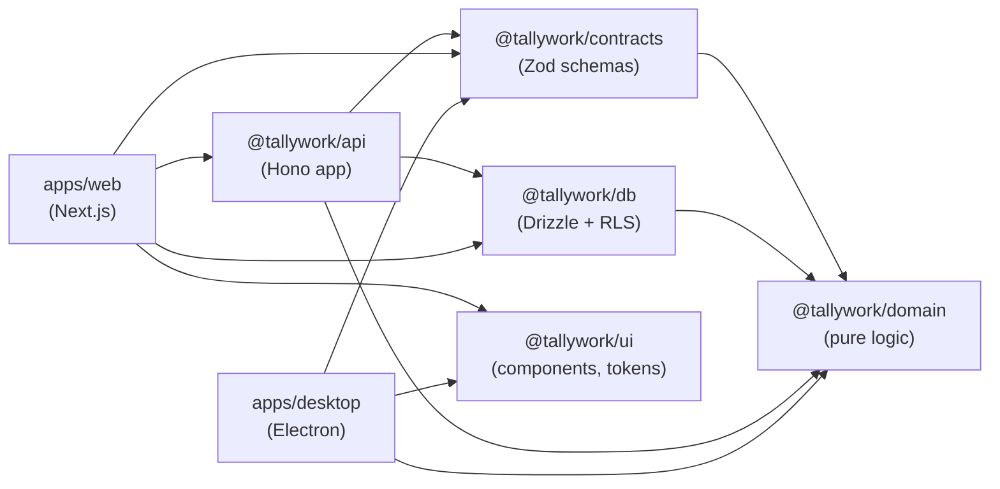

The rule is that **domain has no dependencies on I/O**. The session state machine, time maths, permission evaluation and billing calculations are pure functions. They are unit-tested in isolation and reused by the API and the desktop agent.

---

## System architecture

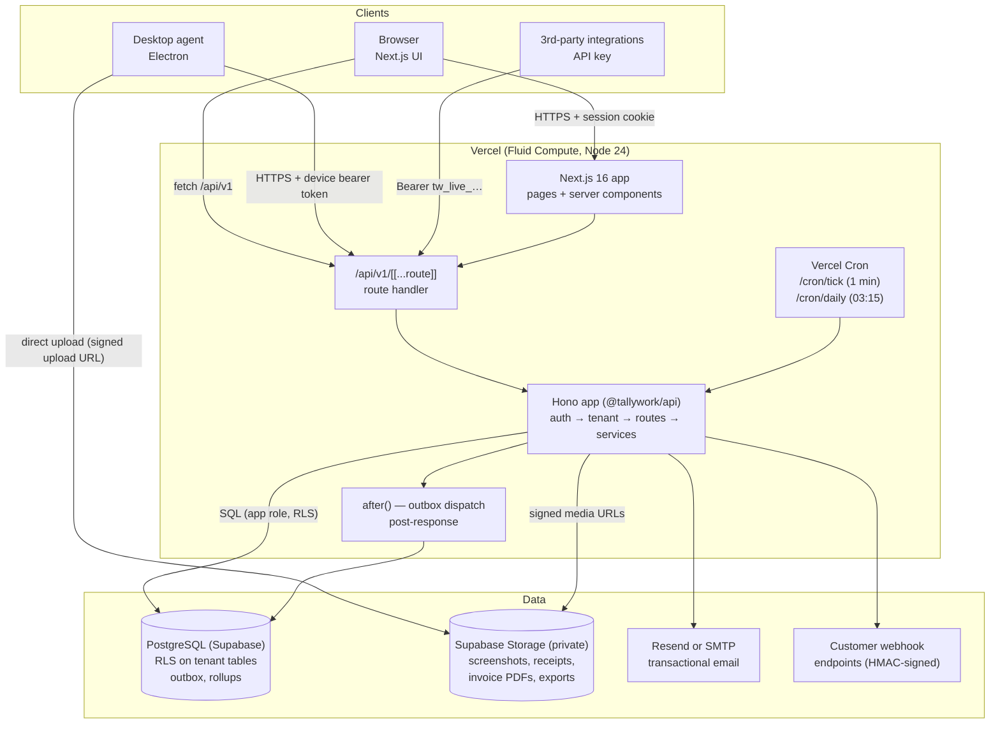

**Key design decisions** (full ADRs are in [docs/plan/08-decisions.md](docs/plan/08-decisions.md)):

1. **A modular monolith in one deployment.** The Hono API runs inside the Next.js app, so there is no CORS and cookies stay simple. Hono is framework-agnostic, so the API can be moved into its own project later without code changes.
2. **The server owns time.** Web and desktop clients send *commands* (start/stop/pause) and *observations* (activity, idle, screenshots). The server decides session state, corrects for device clock skew, and derives time entries. Clients never write time entries directly.
3. **History is append-only.** Every edit to tracked time creates a new `time_entry_revisions` row. Idle discards, manual edits, splits, and screenshot-driven removals are all recorded with the actor and the reason.
4. **Tenant isolation is enforced twice.** Services always scope by `organization_id`, and PostgreSQL RLS acts as a backstop. The app connects as a restricted `tallywork_app` role that cannot bypass RLS.
5. **Privacy is decided at the source.** The agent only collects what the effective policy allows. Keystrokes are *counted*, never recorded. Screenshots are blurred on the device when policy says so. URLs are cut down to the domain on the device in domain-only mode.
6. **No always-on worker.** Side effects go through an outbox. They are dispatched right after the response via `after()`, with a per-minute cron as a backstop. An opportunistic, DB-lease-guarded tick also runs if cron is unavailable.

### Request pipeline (Hono)

```mermaid
flowchart LR
  req["Request /api/v1/..."] --> rid["request-id +<br/>secure headers"]
  rid --> authn["authenticate<br/>device token → API key → session cookie"]
  authn --> tenant["tenant middleware<br/>/orgs/:orgId/*<br/>membership + permissions"]
  tenant --> tx["withTenant(tx)<br/>SET app.org_id"]
  tx --> svc["route → service<br/>(domain logic, Zod input)"]
  svc --> outbox["write outbox event<br/>(same transaction)"]
  outbox --> res["JSON response<br/>or problem+json"]
  res -.-> disp["after(): dispatchOutbox()"]
```

---

## How it works

### 1. Onboarding

```mermaid
sequenceDiagram
  actor Admin
  actor Worker
  participant Web as Web app
  participant API as API
  participant DB as Postgres

  Admin->>Web: Sign up (name, email, password, org name, timezone)
  Web->>API: POST /auth/signup
  API->>DB: create user, organization, built-in roles, owner membership
  alt REQUIRE_EMAIL_VERIFICATION=true
    API-->>Web: verification_required (no session) → "Check your email"
    Admin->>Web: Open emailed link → POST /auth/verify-email
  end
  API-->>Web: session cookie (tw_session)
  Admin->>Web: Create teams, clients, projects, tasks; set tracking policy
  Admin->>API: POST /orgs/:id/invitations (email, role, teams)
  API-->>Worker: invitation email
  Worker->>Web: Open invite link → set name + password
  Web->>API: POST /auth/invitations/accept
  API->>DB: verified user, membership (WORKER) + worker_profile + team membership
  API-->>Web: role_key = WORKER → /download (desktop app)
```

With email verification required, sign-up does not start a session. Opening the emailed link does (unless the account has 2FA), and **Resend** on the "Check your email" screen calls `POST /auth/verify-email/resend`. Login refuses unconfirmed accounts with `email_not_verified`.

**Who is tracked.** The owner and invited admins and managers start with tracking **off** (`worker_profiles.tracking_enabled = false`), so they don't appear in Live tracking. Invited Workers start with it on. Admins switch it per person on the Workers page. Anyone whose role only sees their own work (the Worker role, or a custom one like it) is sent from the web workspace to `/download`.

### 2. Desktop agent sign-in

People sign in inside the app with their email and password:

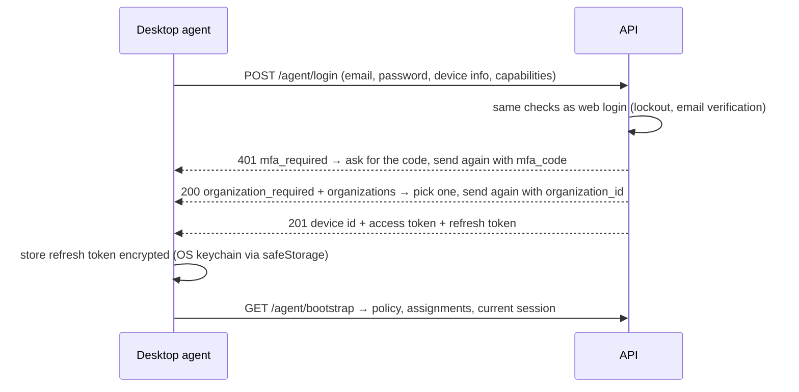

The password is sent once to the server and never stored; only the device refresh token is kept. `POST /agent/login` is limited to 20 attempts per 15 minutes. **Sign in with browser instead** uses PKCE, so the password is typed only in the browser:

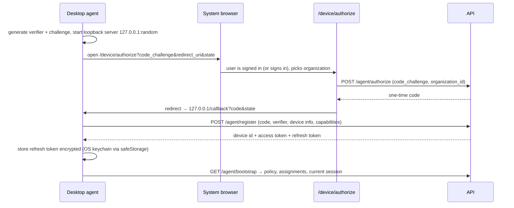

### 3. Time tracking session lifecycle

The session state machine lives in [packages/domain/src/session-machine.ts](packages/domain/src/session-machine.ts). It is pure: a `(state, trigger)` pair returns the next state plus the operation to apply to the session's time segments (open / close a WORK, IDLE or BREAK segment). Only one live session is allowed per worker. Starting a new one elsewhere supersedes the old one.

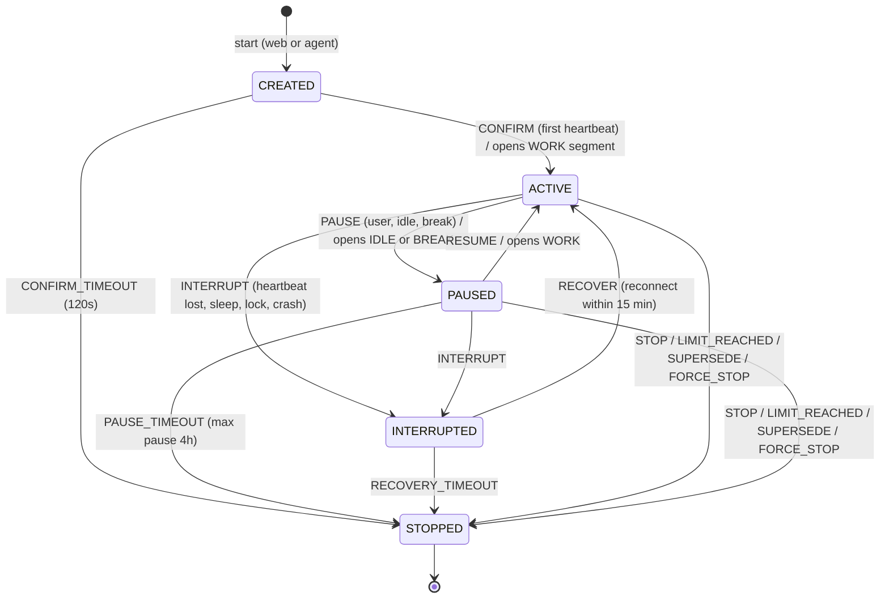

Default timings (these can be overridden per org through the tracking policy): confirm timeout 120s, heartbeat grace 180s, recovery window 15 min, max pause 4 h, max offline tracking 24 h.

### 4. Desktop tracking & offline sync

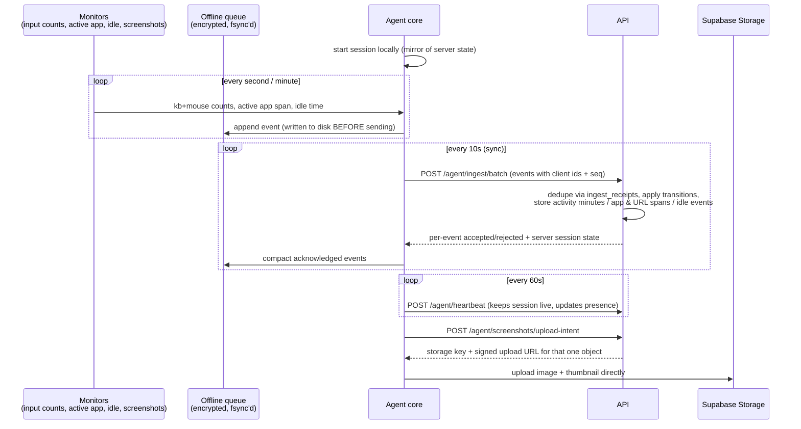

If the network drops, events keep accumulating in the encrypted queue and are replayed once connectivity returns. The server reconciles them against its own state, so no tracked time is lost. After every sync the agent adopts the server's version of the session state.

**Screenshot schedule.** Captures follow the clock's 10-minute blocks (:00–:10, :10–:20, …), the same blocks shown on the Activity page. With *N per 10 minutes*, each block is split into N equal parts and one capture lands at a random moment in each part. A session that starts mid-block still gets captures in the rest of that block. Every capture photographs **all displays** at the same moment, and the Activity page shows them side by side (Screen 1, Screen 2, …). A block with only a minute or two of tracking can miss its capture if the timer stops before the random moment. Failures are logged by the agent as `[screenshots] capture skipped: <reason>`.

**Website (URL) capture.** macOS exposes the active tab's URL to the agent directly. On Windows the agent asks, in order:

1. **The Tallywork browser extension** ([apps/extension](apps/extension/README.md)) for the foreground browser. It reports the active tab to the agent over `http://127.0.0.1:47816–47818`. The agent only accepts requests whose `Origin` is the extension's fixed ID and whose `Host` is loopback. When the extension says the focused window is one it cannot see (incognito, DevTools), **nothing is recorded** and there is no fallback.
2. **The address bar**, read through Windows UI Automation by a small PowerShell helper, when the extension is not installed. It skips while the address bar has keyboard focus, so typed text is never recorded as a visit.

Either way, *Domain only*, excluded domains and http/https-only are applied on the device before anything is stored, and nothing is recorded unless a timer is running.

### 5. From tracked time to money

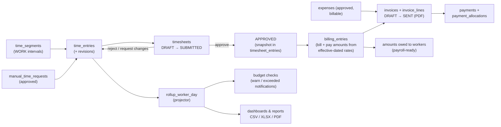

### 6. Events & background jobs

Every state-changing service writes a domain event to `outbox_events` **in the same transaction** as the change. Events are dispatched after the response, or by cron. Handlers update rollups, check budgets, send notifications and email, and queue webhook deliveries.

| Event | What the handler does |
|---|---|
| `time.changed` | Recompute `rollup_worker_day` for the affected dates; check project budgets |
| `usage.recorded` | Recompute `rollup_app_day` (app / URL usage) |
| `timesheet.submitted` / `approved` / `rejected` / `changes_requested` / `reopened` | Notify approvers or the worker |
| `manual_time.requested` / `approved` / `rejected` | Notify approvers or the worker |
| `time_off.requested` / `approved` / `rejected` | Notify approvers or the worker |
| `expense.submitted` | Notify approvers |
| `policy.changed` | Notify affected workers and devices |
| `device.offline` | Notify managers |
| `payment.received`, `invoice.overdue` | Notify finance users |

All events can also be delivered to customer **webhooks**. Deliveries are HMAC-signed, retried with backoff, and endpoints are auto-disabled after repeated failures.

| Job | Schedule | Work |
|---|---|---|
| `runTick` | `/api/v1/cron/tick` — every minute | Sweep sessions (confirm / pause / recovery timeouts, limits), mark silent devices offline, dispatch outbox, deliver webhooks, start and continue screenshot cleanups ([docs/ops/screenshot-retention.md](docs/ops/screenshot-retention.md)) |
| `runDaily` | `/api/v1/cron/daily` — 03:15 UTC | Retention cleanup (activity, app / URL data, audit, …), overdue screenshot-cleanup alerts, time-off accruals, overdue invoices, housekeeping |

Both cron endpoints require `Authorization: Bearer $CRON_SECRET`.

### 7. The worker desktop app

The desktop app is the worker's whole workspace, not only a timer. It opens as a dashboard (1120×760) and collapses to a compact single column when the window is narrow. There is a side rail from 1024px wide, and a slide-in menu below that. After signing in, a worker goes straight to Home and can start the timer. There is no first-run policy screen to acknowledge.

| Area | Contents |
|---|---|
| **Top bar** | organization name, online/offline, sync status, notifications (unread count, mark read), profile menu (name, email, organization, **Sign out**) |
| **Sidebar** | Home · Track · Timesheet · Time off · Schedule · Pay stubs · Settings. Track and Timesheet open a tab bar for their related screens; the others open one page each |
| **Home** | greeting · timer card (project and task, large timer, Pause / Break / Stop) · needs attention (a timesheet to submit or fix, manual time still waiting to sync; hidden when there is nothing to do) · quick actions (work note while tracking, manual time when the policy allows it, my timesheet) · current session · recent sessions · today's summary (tracked, active, **idle**, activity %, limits, shift) · your activity for the last hour |
| **Track** | tabs: Projects · Tasks · Sessions (sessions by day, manual time) |
| **Timesheet** | tabs: Timesheet (period grid, **submit**) · Activity (own 10-minute blocks, apps, websites; screenshots stay on the web) · Reports (personal only) |
| **Other pages** | Time off (balances, requests, **request**) · Schedule · Pay stubs (finalized stubs, PDF download) · Settings (signed in as, organization, device status, version, sign out, quit) |

The sidebar is plain data in [nav.ts](apps/desktop/src/renderer/src/nav.ts), unit-tested in [nav.test.ts](apps/desktop/test/nav.test.ts), so every screen stays reachable.

The data comes from the **device own-data API** (`/api/v1/agent/me/*`, see [Security model](#security-model)). The window asks the main process through one IPC channel with a fixed list of resources. Main builds the API path itself, so the token never reaches the window.

---

## Data model (ERD)

Conventions (see [packages/db/src/schema/](packages/db/src/schema/)):

- Primary keys are **UUIDv7** (`id uuid`), which are time-sortable.
- Every tenant table has `organization_id uuid NOT NULL`. Relations use **composite foreign keys** `(organization_id, x_id)`, so a row can never point at another tenant's row.
- Money is `amount_minor bigint` + `currency`. Durations are **seconds** (`integer`). Timestamps are `timestamptz` in UTC. Calendar dates are ISO strings (`local_date`) in the worker's timezone.
- Business entities are soft-archived (`archived_at`). Hard deletes happen only through retention jobs.
- Column names are snake_case (Drizzle `casing: 'snake_case'`).

The diagrams below are split by domain for readability. `organizations` is the root of every tenant table (not all of those edges are drawn).

### Identity, organization & workforce

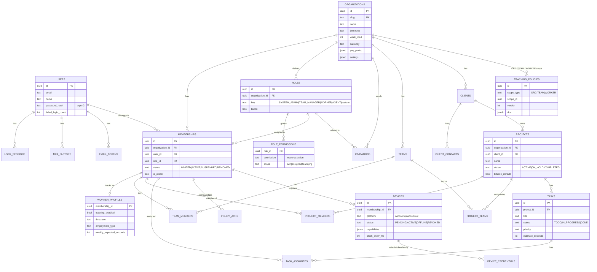

### Tracking, activity & timesheets

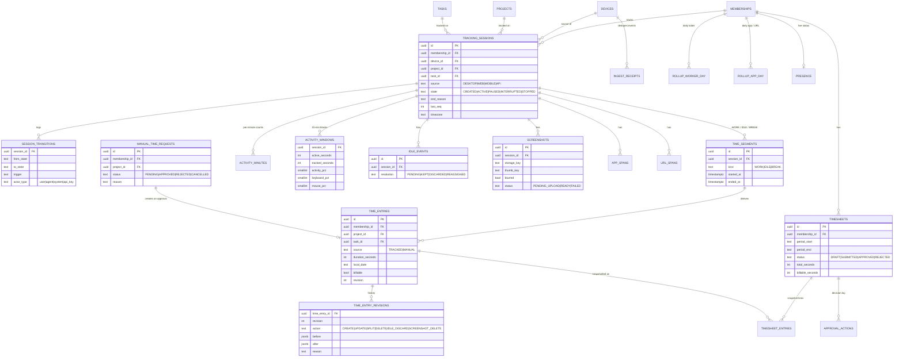

### Operations, finance & platform

```mermaid
erDiagram
  MEMBERSHIPS ||--o{ WORK_SCHEDULES : has
  WORK_SCHEDULES ||--o{ SHIFTS : generates
  MEMBERSHIPS ||--o{ ATTENDANCE_DAYS : "derived daily"
  ORGANIZATIONS ||--o{ HOLIDAYS : has
  TIME_OFF_POLICIES ||--o{ TIME_OFF_POLICY_MEMBERS : "applies to"
  TIME_OFF_POLICIES ||--o{ TIME_OFF_REQUESTS : governs
  TIME_OFF_POLICIES ||--o{ TIME_OFF_LEDGER : "balance movements"
  TIME_OFF_REQUESTS ||--o{ TIME_OFF_LEDGER : "debits / reversals"
  ORGANIZATIONS ||--o| OVERTIME_RULE_SETS : has

  ORGANIZATIONS ||--o{ BILLING_RATES : "pay / bill, effective-dated"
  TIME_ENTRIES ||--o{ BILLING_ENTRIES : "priced as"
  BILLING_RATES ||--o{ BILLING_ENTRIES : "applied"
  PROJECTS ||--o{ BUDGETS : "subject"
  CLIENTS ||--o{ BUDGETS : "subject"
  MEMBERSHIPS ||--o{ EXPENSES : submits
  FILE_OBJECTS ||--o| EXPENSES : receipt
  CLIENTS ||--o{ INVOICES : billed
  INVOICES ||--o{ INVOICE_LINES : has
  INVOICE_LINES ||--o{ BILLING_ENTRIES : invoices
  INVOICE_LINES ||--o{ EXPENSES : "passes through"
  PAYMENTS ||--o{ PAYMENT_ALLOCATIONS : "split into"
  INVOICES ||--o{ PAYMENT_ALLOCATIONS : "paid by"
  ORGANIZATIONS ||--o| INVOICE_SEQUENCES : numbering

  MEMBERSHIPS ||--o{ NOTIFICATIONS : receives
  MEMBERSHIPS ||--o{ NOTIFICATION_PREFERENCES : sets
  MEMBERSHIPS ||--o{ DASHBOARD_LAYOUTS : owns
  MEMBERSHIPS ||--o{ SAVED_REPORTS : owns
  MEMBERSHIPS ||--o{ REPORT_RUNS : runs
  FILE_OBJECTS ||--o| REPORT_RUNS : output
  ORGANIZATIONS ||--o{ API_KEYS : issues
  ORGANIZATIONS ||--o{ WEBHOOK_ENDPOINTS : configures
  WEBHOOK_ENDPOINTS ||--o{ WEBHOOK_DELIVERIES : attempts
  ORGANIZATIONS ||--o{ AUDIT_LOGS : records
  ORGANIZATIONS ||--o{ OUTBOX_EVENTS : emits
  ORGANIZATIONS ||--o{ RETENTION_POLICIES : sets

  BILLING_RATES {
    uuid id PK
    text kind "PAY|BILL"
    text scope "ORG|CLIENT|PROJECT|WORKER|PROJECT_WORKER"
    bigint amount_minor
    text currency
    text effective_from
    text effective_to
  }
  BILLING_ENTRIES {
    uuid id PK
    uuid time_entry_id FK
    int revision
    int seconds
    bigint bill_amount_minor
    bigint pay_amount_minor
    uuid invoice_line_id FK
  }
  INVOICES {
    uuid id PK
    uuid client_id FK
    text number
    text status "DRAFT|SENT|VOID"
    bigint total_minor
    bigint paid_minor
  }
  EXPENSES {
    uuid id PK
    text category
    bigint amount_minor
    bool billable
    bool reimbursable
    text status "SUBMITTED|APPROVED|REJECTED|REIMBURSED"
  }
  BUDGETS {
    uuid id PK
    text subject_type "PROJECT|CLIENT"
    text kind "HOURS|MONEY"
    bigint amount
    int warn_pct
  }
  TIME_OFF_REQUESTS {
    uuid id PK
    text start_date
    text end_date
    numeric hours
    text status "PENDING|APPROVED|REJECTED|CANCELLED"
  }
  OUTBOX_EVENTS {
    uuid id PK
    text event_type
    jsonb envelope
    int attempts
  }
  AUDIT_LOGS {
    uuid id PK
    text actor_type
    text action
    jsonb before
    jsonb after
    text request_id
  }
```

**Tables without RLS** (they have no `organization_id`, or must be readable before a tenant is known): `organizations`, `users`, `user_sessions`, `mfa_factors`, `email_tokens`, `device_auth_codes`, `idempotency_keys`, `rate_limit_buckets`.

---

## Security model

- **Principals:** each request resolves to exactly one principal, checked in this order:
  1. device bearer token (desktop **agent**)
  2. API key (`Bearer tw_live_<prefix>_<secret>`)
  3. session cookie (`tw_session`, **user**)
- **Authorization:** a permission is `resource:action` plus a **scope** (`own`, `assigned`, `team`, `org`). Roles are data (`roles`, `role_permissions`). The built-in presets are `SYSTEM_ADMIN`, `TEAM_MANAGER`, `WORKER` and `AGENT`. For list endpoints the evaluator returns a query filter, so single reads, lists, reports and exports all follow the same rule. See [packages/domain/src/permissions.ts](packages/domain/src/permissions.ts) and the full matrix in [docs/plan/05-security-api.md](docs/plan/05-security-api.md).
- **Checks in layers:** route guard (`requirePermission`) → service-level scope check → PostgreSQL RLS (`app.org_id` set per transaction via `withTenant`). Cross-tenant system jobs must explicitly use `withSystem`.
- **Agent constraints:** a device credential is bound to `(organization, membership, device)`. It writes only that worker's tracking data. Revoking the device kills its tokens and access immediately (checked on every request). Refresh tokens rotate within a family.
- **Device own-data API (`/agent/me/*`):** the desktop app may read back **only its bound worker's own data** (sessions, timesheet, activity summary, tasks, schedule, time off, notifications, personal totals, and pay stubs from finalized payrolls). It goes through the web app's own services, with the worker's grants narrowed to an allowlist at `own` scope (`projects:read` / `tasks:read`: `assigned`). **Screenshots are never returned to a device**; a team manager's or admin's device is just as narrow as a worker's. Pay stub PDFs are fetched by the main process and saved only where the person chooses. The only writes are submitting a timesheet, requesting time off and marking notifications read. Ranges are capped at 93 days, and reads and writes are rate-limited. See [agent-me.ts](packages/api/src/services/agent-me.ts) and ADR-121 in [08-decisions.md](docs/plan/08-decisions.md).
- **Browser extension bridge:** local-only (`127.0.0.1`), accepts only the extension's fixed ID as `Origin` and a loopback `Host` (defeats web pages and DNS rebinding), and never sees incognito windows.
- **Secrets:** passwords are hashed with Argon2. Session tokens, API keys and refresh tokens are stored only as hashes. MFA and webhook secrets are encrypted with a key derived from `APP_SECRET`.
- **Media:** screenshots are private blobs. They are served only through `/api/v1/media/:token`, a short-lived HMAC-signed URL issued after authorization.
- **Hardening:** secure headers (HSTS, frame-deny, nosniff, strict referrer, permissions policy), `Cache-Control: no-store` by default, rate limits (login, verification resend, agent login/register/token, ingest, heartbeat; stored in Postgres), SSRF protection on webhook URLs, and an audit log with request ids.
- **Desktop:** context isolation plus a sandboxed renderer with a minimal typed preload API (no generic `invoke`). Electron fuses are hardened (no `runAsNode`, ASAR integrity, only loads from ASAR). The refresh token and offline queue are AES-256-GCM encrypted with a data key wrapped by the OS keychain. The agent refuses to store credentials if no keychain is available.

---

## API overview

Base path: **`/api/v1`**. JSON in and out. Errors use `application/problem+json` with `code` and `request_id`.

| Area | Endpoints (prefix `/orgs/:orgId` unless shown) |
|---|---|
| Health & infra | `GET /health`, `GET /media/:token`, `GET /cron/tick`, `GET /cron/daily` |
| Auth (`/auth`) | `signup`, `login`, `logout`, `password/forgot`, `password/reset`, `password/change`, `verify-email` (+ `resend`), `invitations/accept` |
| Me (`/me`) | `GET /me`, `POST /me/organizations` |
| Agent (`/agent`) | `login`, `authorize`, `register`, `token`, `bootstrap`, `policy/ack`, `ingest/batch`, `heartbeat`, `screenshots/upload-intent`, `screenshots/upload` |
| Agent own data (`/agent/me`) | `summary`, `sessions`, `timesheet` (+ `submit`), `activity`, `tasks`, `schedule`, `time-off` (+ request), `notifications` (+ `read`), `pay-stubs` (+ `:id/pdf`). Device token only; bound worker only |
| Organization | org settings, `roles`, `workers`, `invitations`, `teams`, `clients`, `projects`, `tasks`, `me/assignments`, `policies/:scope`, `devices` |
| Tracking & time | `tracking/{current,start,stop,pause,resume,switch,note,live}`, `sessions`, `time-entries`, `manual-time`, `timesheets` (+ `submit`, `approvals`, `bulk-approve`), `activity/day`, `screenshots`, `idle-events` |
| Operations | `schedules`, `shifts`, `attendance`, `holidays`, `time-off/{policies,balances,requests}` |
| Finance | `rates`, `billing/amounts-owed`, `budgets`, `expenses`, `invoices` (+ `preview`, `pdf`, `send`, `void`), `payments` |
| Insight | `dashboard/{layout,widgets}`, `reports` (+ `:key/query`, `:key/export`), `saved-reports`, `notifications`, `notification-preferences` |
| Platform | `api-keys`, `webhooks` (+ deliveries, replay, test), `audit-logs`, `retention-policies`, `files` |

Route definitions: [packages/api/src/routes/](packages/api/src/routes/). Input schemas: [packages/contracts/src/](packages/contracts/src/).

---

## Getting started

### Prerequisites

- **Node.js 24+**
- **pnpm 10** (`corepack enable` picks up the version pinned in `package.json`)
- For the desktop agent on macOS: grant *Accessibility / Input Monitoring* and *Screen Recording* permissions when prompted.

### Run locally (no external services needed)

```bash
pnpm install

# Optional: fill the local database with a demo org (30 workers, 14 days of data).
# Run this BEFORE starting the dev server (PGlite is single-process).
pnpm --filter @tallywork/web seed

# Start the web app + API on http://localhost:3000
pnpm dev
```

With no `DATABASE_URL`, the app uses a **file-backed PGlite** database at `apps/web/.data/pglite`, migrated automatically on boot. Files go to `apps/web/.data/blobs`, and emails (sign-up confirmation, password reset, invitations) are printed to the server console, links included. Delete `apps/web/.data/` to start fresh.

**Demo login** (after seeding locally): `admin@demo.tallywork.app` / `demo-password-123`. A deployed demo is seeded with its own `SEED_PASSWORD`, so this password never opens it.

### Run the desktop agent

```bash
# in a second terminal, with the web app running on :3000
pnpm --filter @tallywork/desktop dev
```

In development the agent talks to `http://localhost:3000`. Set `TALLYWORK_SERVER` to point it somewhere else. Sign in with an account's email and password (for example the demo login), or choose **Sign in with browser instead** to approve the device on the web's device-authorization page.

> **`The requested module 'electron' does not provide an export named 'BrowserWindow'`** means `ELECTRON_RUN_AS_NODE=1` is set in your terminal. VS Code and tools inside it set this, and it makes Electron run as plain Node. Start the app without it:
> `env -u ELECTRON_RUN_AS_NODE pnpm --filter @tallywork/desktop dev` (bash) or `Remove-Item Env:ELECTRON_RUN_AS_NODE; pnpm --filter @tallywork/desktop dev` (PowerShell).

The app is single-instance: if an older copy is still running in the system tray, a new launch just focuses it. Quit the tray copy first when you want new main-process code.

**Browser extension (Windows website tracking):** open `chrome://extensions` (or `edge://extensions`) → turn on **Developer mode** → **Load unpacked** → choose `apps/extension`. Its popup shows whether the desktop app is connected and whether websites are being recorded. Without it, the agent falls back to reading the address bar.

### Use Supabase (database + file storage)

Put these in `apps/web/.env` (or `apps/web/.env.local`). Leave a key commented out until you have its value, because an empty `KEY=` counts as set and turns off the local fallbacks.

```bash
# Supabase → Connect → Session pooler (port 5432). Not the direct host or port 6543.
DATABASE_URL=postgresql://postgres.<project-ref>:<password>@aws-0-<region>.pooler.supabase.com:5432/postgres
# Supabase → Project Settings → API Keys (service_role or a Secret key). Server only.
SUPABASE_URL=https://<project-ref>.supabase.co
SUPABASE_SERVICE_ROLE_KEY=<service-role-key>
```

```bash
pnpm db:migrate                      # apply migrations + RLS policies + tallywork_app role
pnpm --filter @tallywork/web seed    # optional: demo org
pnpm dev
```

`pnpm db:migrate` reads `DATABASE_URL` from, in order: real environment variables, `packages/db/.env`, `apps/web/.env.local`, `apps/web/.env`. So one copy in the web app's env file is enough. The storage bucket (`tallywork`, private) is created automatically on the first upload.

In Supabase, also disable the **Data API** (Project Settings → Data API). The app doesn't use it. See ADR-113 in [08-decisions.md](docs/plan/08-decisions.md).

Any other Postgres works too: set `DATABASE_URL` and skip the `SUPABASE_*` keys, and files stay on local disk (or use `BLOB_READ_WRITE_TOKEN` for Vercel Blob).

### Send real email

Set **one** provider in `apps/web/.env`. If both are set, Resend wins. With neither, emails go to the server console.

- **Resend:** `RESEND_API_KEY`, and `MAIL_FROM` with an address on a domain verified in Resend.
- **SMTP, e.g. Gmail:** turn on 2-Step Verification for the Google account, create an [app password](https://myaccount.google.com/apppasswords), then:

  ```bash
  SMTP_HOST=smtp.gmail.com
  SMTP_PORT=465
  SMTP_USER=you@gmail.com
  SMTP_PASS=<16-character app password>
  ```

  `MAIL_FROM` defaults to `WorkPulse <SMTP_USER>`, because Gmail replaces any other sender with the signed-in account.

Set `REQUIRE_EMAIL_VERIFICATION=true` once email works: new accounts must then open the emailed link before they can sign in.

---

## Commands

Run from the repo root unless noted.

| Command | What it does |
|---|---|
| `pnpm install` | Install all workspace dependencies |
| `pnpm dev` | Start the web app + API (`next dev` on port 3000) |
| `pnpm build` | Build every package / app via Turborepo |
| `pnpm typecheck` | Type-check every workspace |
| `pnpm test` | Run all Vitest suites |
| `pnpm test:e2e` | Run the Playwright E2E suite: builds, starts isolated servers on :3100/:3101, runs, reports ([e2e/README.md](e2e/README.md)) |
| `pnpm test:e2e:smoke` | Only the critical E2E journeys (`@smoke`) |
| `pnpm test:e2e:install` | Install the Playwright browsers (first run) |
| `pnpm test:e2e:ui` / `:headed` / `:debug` / `:report` | Interactive runner, visible browser, inspector, last HTML report |
| `pnpm lint` | Run lint tasks |
| `pnpm db:generate` | Generate a new SQL migration from schema changes (`drizzle-kit generate`) |
| `pnpm db:migrate` | Apply migrations, RLS policies and app-role grants to `DATABASE_URL` |
| `pnpm --filter @tallywork/web seed` | Seed the demo organization (`SEED_DAYS`, `SEED_WORKERS`, `SEED_SCREENSHOT_DAYS` tune the size; `SEED_PASSWORD` sets a private password for every demo account, required for any database reachable from the internet) |
| `pnpm --filter @tallywork/web start` | Serve a production build |
| `pnpm --filter @tallywork/desktop dev` | Run the Electron agent with hot reload |
| `pnpm --filter @tallywork/desktop build` | Build the agent (`out/`) |
| `pnpm --filter @tallywork/desktop dist` | Build installers for the current OS (`release/<version>/`) |
| `pnpm --filter @tallywork/desktop dist:win` \| `dist:mac` \| `dist:linux` | Build installers for a specific OS (NSIS + MSI / DMG + ZIP + PKG / AppImage + deb) |
| `pnpm --filter @tallywork/desktop release:win` | Build the Windows installer and publish it as a GitHub Release (see [Deployment](#deployment)) |
| `pnpm --filter <pkg> test` | Run one package's tests, e.g. `@tallywork/api` |

### Changing the database schema

1. Edit tables in [packages/db/src/schema/](packages/db/src/schema/). Remember `organization_id` and composite FKs for tenant data.
2. `pnpm db:generate` creates a migration in `packages/db/migrations/`.
3. `pnpm db:migrate` (or restart `pnpm dev` with PGlite) applies it. RLS is re-applied automatically to every table that has `organization_id`.
4. Add or update tests; [packages/db/test/rls.test.ts](packages/db/test/rls.test.ts) checks tenant isolation.

---

## Environment variables

### Web / API (`apps/web`)

| Variable | Required | Description |
|---|---|---|
| `DATABASE_URL` (or `POSTGRES_URL`) | Production | `postgres://…` (Supabase Session pooler, port 5432), `pglite://memory`, or `pglite://<path>`. Defaults to file PGlite in dev |
| `DB_POOL_MAX` | No | Database connections per server instance (default 10). Instances × this must stay under the Session pooler's pool size |
| `DB_CONNECT_TIMEOUT_MS` | No | How long a request waits for a free connection before failing with 503 `service_busy` (default 10000) |
| `DB_STATEMENT_TIMEOUT_MS` | No | Longest a single query may run; longer ones are cancelled and return 503 (default 30000) |
| `DB_IDLE_IN_TX_TIMEOUT_MS` | No | Longest a transaction may sit idle before Postgres closes its connection (default 120000) |
| `APP_SECRET` | Production | ≥ 32 chars; HMAC signing (tokens, media URLs) and field encryption. Dev uses an insecure default |
| `APP_URL` | No | Public base URL. Defaults to the Vercel URL, or `http://localhost:3000` |
| `CRON_SECRET` | Production | Bearer secret that Vercel Cron sends to `/api/v1/cron/*` |
| `SUPABASE_URL` | Production | `https://<project-ref>.supabase.co`; enables Supabase Storage together with the key below |
| `SUPABASE_SERVICE_ROLE_KEY` | Production | Service-role / secret key (server only). Used for Storage; never sent to clients |
| `SUPABASE_STORAGE_BUCKET` | No | Private bucket name (default `tallywork`, created automatically) |
| `BLOB_READ_WRITE_TOKEN` | No | Vercel Blob token, used only when Supabase Storage is not configured. With neither, files go to `LOCAL_STORAGE_DIR` |
| `LOCAL_STORAGE_DIR` | No | Local file storage directory (default `apps/web/.data/blobs`) |
| `RESEND_API_KEY` | No | Enables real email through Resend (takes precedence over SMTP) |
| `SMTP_HOST` | No | Enables email over SMTP when `RESEND_API_KEY` is not set (e.g. `smtp.gmail.com`) |
| `SMTP_PORT` | No | Default `465` (implicit TLS); use `587` for STARTTLS |
| `SMTP_SECURE` | No | `true`/`false`; defaults to `true` on port 465 |
| `SMTP_USER` / `SMTP_PASS` | No | SMTP credentials. For Gmail: the account address and a 16-character [app password](https://myaccount.google.com/apppasswords) (requires 2-Step Verification) |
| `MAIL_FROM` | No | Sender address (default `WorkPulse <no-reply@tallywork.app>`, or `WorkPulse <SMTP_USER>` with SMTP) |
| `REQUIRE_EMAIL_VERIFICATION` | No | `true`: new accounts stay signed out until they open the emailed link (which then signs them in, unless they use 2FA); unverified accounts cannot sign in on the web or the desktop app (`email_not_verified`). Invited people are verified when they accept |
| `SESSION_TTL_HOURS` | No | Web session lifetime (default 336 = 14 days) |
| `MIN_AGENT_VERSION` | No | Oldest desktop agent version the API accepts (default `0.1.0`) |
| `DESKTOP_DOWNLOAD_URL_WINDOWS` / `_MACOS` / `_LINUX` (the `.deb`) / `_LINUX_APPIMAGE` | No | Installer links shown on `/download`, where Workers land after accepting an invitation (Workers use the desktop app only). Read at request time, so no rebuild is needed. Use the always-latest links, e.g. `https://github.com/marketingcad/tallywork-desktop/releases/latest/download/Tallywork-Setup.exe` (`Tallywork-mac.dmg`, `Tallywork-linux.deb`, `Tallywork-linux.AppImage`). Without them the page asks the worker to get the installer from their administrator |

### Desktop agent (`apps/desktop`)

| Variable | Description |
|---|---|
| `TALLYWORK_SERVER` | API server URL (default `http://localhost:3000` in dev, the production URL when packaged) |
| `TALLYWORK_UPDATE_URL` | Optional self-hosted auto-update feed (a generic electron-updater feed). By default packaged builds update from GitHub Releases in `marketingcad/tallywork-desktop` |
| `TALLYWORK_UPDATE_CHANNEL` | `beta` to also receive prerelease versions (default `latest`). A managed `UpdateChannel` overrides it |
| `TALLYWORK_CRASH_URL` | Where crash reports (minidumps only) are sent, for the crash-free SLO |
| `TALLYWORK_EXTENSION_IDS` | Extra browser-extension IDs the local bridge accepts (comma-separated), e.g. the Chrome Web Store ID once published. The unpacked extension's ID is built in |
| `DESKTOP_RELEASE_TOKEN` | GitHub Actions secret (not an app variable) for the **Desktop release** workflow: a fine-grained token for `marketingcad/tallywork-desktop` only, Contents: read and write |
| `CSC_LINK`, `CSC_KEY_PASSWORD` | Code-signing certificate for Windows / macOS installers. Not used yet: releases are unsigned |
| `APPLE_ID`, `APPLE_APP_SPECIFIC_PASSWORD`, `APPLE_TEAM_ID` | macOS notarization, once there is an Apple Developer account. Not used yet |

---

## Testing & CI

Tests use **Vitest** with an in-memory **PGlite** database. This is real Postgres, including RLS, with no Docker needed. **Playwright** E2E tests drive the real web app, the desktop app's window in Chromium and the real Electron app against an isolated server (fresh in-memory database, no email or storage services): one command, `pnpm test:e2e`. See [e2e/README.md](e2e/README.md). Every new or changed feature ships with tests that were run: see [AGENTS.md](AGENTS.md).

| Suite | Covers |
|---|---|
| [packages/domain/test](packages/domain/test/) | State machine transitions, time maths, policies, permissions, billing |
| [packages/db/test/rls.test.ts](packages/db/test/rls.test.ts) | Row-level security: org A can never read or write org B |
| [packages/api/test/flow.test.ts](packages/api/test/flow.test.ts) | End-to-end API flows: signup → track → timesheet → approve → invoice |
| [packages/api/test/tracking.test.ts](packages/api/test/tracking.test.ts) | Session engine, idle handling, agent ingest, offline replay |
| [packages/api/test/security.test.ts](packages/api/test/security.test.ts) | Authorization by role and scope, tenant isolation, token handling |
| [packages/api/test/seed.test.ts](packages/api/test/seed.test.ts) | Demo seeder runs cleanly |
| [packages/api/test/invitations.test.ts](packages/api/test/invitations.test.ts) | Invitations with teams, a team role and projects: applied on accept (new and returning members), cross-workspace and archived targets refused |
| [packages/api/test/payroll.test.ts](packages/api/test/payroll.test.ts) | Payroll runs, bank details, pay stubs on the web and on the desktop (own finalized stubs only, even from an admin's device) |
| [apps/web/test/csv-import.test.ts](apps/web/test/csv-import.test.ts) | CSV time import: parsing (quotes, BOM, semicolons), column mapping, and every row check before rows are sent as manual time |
| [packages/api/test/agent-me.test.ts](packages/api/test/agent-me.test.ts) | Device own-data API: only the bound worker, never screenshots, managers narrowed to own, revoked devices refused |
| [packages/api/test/storage.test.ts](packages/api/test/storage.test.ts) | Supabase Storage adapter: bucket setup, upload, signed upload URLs, delete batching, error handling |
| [apps/desktop/test/agent.test.ts](apps/desktop/test/agent.test.ts) | Agent core: privacy contract, activity minutes and history, screenshot schedule, IPC contract, manual time |
| [apps/desktop/test/agent-start.test.ts](apps/desktop/test/agent-start.test.ts) | Starting the timer: no policy acknowledgement needed, still refused when the organization turns desktop tracking off |
| [apps/desktop/test/nav.test.ts](apps/desktop/test/nav.test.ts) | Sidebar model: the item order, every screen reachable, no orphan views |
| [packages/ui/test](packages/ui/test/) | Shared UI: table pagination, translated messages (placeholders, plurals, fallback to English) and the English message catalog |
| [packages/api/test/new-organization.test.ts](packages/api/test/new-organization.test.ts) | Creating another organization: owner and admin, defaults, kept apart from the first, validation |
| [e2e/tests](e2e/tests/) | Playwright (91 tests). **Web:** sign-in, the last workspace and safe return links, navigation, invitations, the client portal (the dashboard, no money, and who can't open it), CSV import, budgets, invoices and payments, payroll, insights, time types, locking and reminders, duration and part-billable entries, client, project and staff profiles, new organizations and the getting-started checklist, the audit log, server paging of every long list, and who must *not* see money pages. **Desktop window:** navigation and pay stubs. **Electron app:** sign-in, pay stub download, IPC checks, sign-out |
| [apps/desktop/test/urls.test.ts](apps/desktop/test/urls.test.ts) | URL capture: browser detection, address-bar parsing, extension bridge access control (live HTTP), source selection, domain-only trimming |

**CI** ([.github/workflows/ci.yml](.github/workflows/ci.yml)) runs on every push to `main` and on every PR:

- `verify` — install → typecheck packages + web → test domain / ui / db / api / web → build web.
- `desktop` — typecheck, test and build the agent on **Windows, macOS and Linux**.
- `e2e` — Playwright E2E for the web app and the desktop window on Chromium (Ubuntu); `e2e-electron` — the real Electron desktop app (Windows). The HTML report, traces, screenshots and videos are uploaded as artifacts.

Two manual workflows ship the desktop app: **Desktop release** ([desktop-release.yml](.github/workflows/desktop-release.yml)) and **Desktop Linux smoke test** ([desktop-linux-smoke.yml](.github/workflows/desktop-linux-smoke.yml)). See [Deployment](#deployment).

---

## Deployment

The web app and API deploy together to **Vercel** as one project (root directory `apps/web`).

1. In Supabase, copy the **Session pooler** connection string (Connect → Session pooler, port 5432) into `DATABASE_URL`, and set `SUPABASE_URL` + `SUPABASE_SERVICE_ROLE_KEY` for file storage. Don't use the direct host (IPv6-only) or the transaction pooler (port 6543): the app sets a restricted database role per connection, which transaction pooling doesn't preserve. Disable Supabase's Data API (or stop exposing the `public` schema), since the app doesn't use it.
2. Set `APP_SECRET` (32+ random characters) and `CRON_SECRET`. Optionally set `APP_URL`, an email provider (`RESEND_API_KEY` or `SMTP_*`, plus `MAIL_FROM`; see [Send real email](#send-real-email)), `REQUIRE_EMAIL_VERIFICATION=true`, and the `DESKTOP_DOWNLOAD_URL_*` links for `/download`.
3. Deploy. The `vercel-build` script runs `pnpm --filter @tallywork/db migrate` **before** `next build`, so every deploy applies migrations and RLS. Migrations run one at a time (a Postgres advisory lock), so two deploys starting together wait for each other. If a migration fails, the build stops and production keeps serving the previous deployment.
   - **From GitHub (normal):** the project is connected to `marketingcad/WorkPulse` with `main` as the production branch. Every merge into `main` deploys production, and every other branch gets a Preview.
   - **Preview builds:** these should have no database (`DATABASE_URL` set for Production only), so their migrations are skipped and their API returns errors. If Preview is given `DATABASE_URL`, its builds migrate the production database before a merge; see Needs attention. Vercel blocks a Preview when the commit's author isn't a member of the Vercel team.
   - **By hand:** `npx vercel --prod` from the repo root (the folder is linked to the `tallywork` project in `.vercel/`).
   - The live address `tallywork-alpha.vercel.app` is a project domain with **Auto-assign Custom Production Domains** on, so every merge to `main` moves it to the new deployment. A dashboard **Redeploy** (after changing an environment variable) does not move it: promote that deployment (**⋯ → Promote to Production**). To roll back, promote the previous deployment.
4. [apps/web/vercel.json](apps/web/vercel.json) registers the cron jobs (`/api/v1/cron/tick` every minute, `/api/v1/cron/daily` at 03:15 UTC) and gives the API function a 300s max duration.

**Desktop releases** (current version 0.1.8, published 20 October 2026): bump `version` in `apps/desktop/package.json`, push, then run the **Desktop release** workflow (GitHub → Actions → Desktop release → Run workflow, `platforms`: `all`, or one platform to redo a failed build). It creates a draft, builds Windows (NSIS `.exe`), macOS (universal `.dmg` + `.zip`) and Linux (`.AppImage` + `.deb`), and publishes them with the auto-update feed as one GitHub Release in the public `marketingcad/tallywork-desktop` repo (no source code there) once every build has succeeded. It refuses to overwrite a published version, and needs the `DESKTOP_RELEASE_TOKEN` secret (fine-grained token, that repo only, Contents: read and write). Windows only, from your own PC: `pnpm --filter @tallywork/desktop release:win` (token from `gh auth token`). The `.msi` and `.pkg` targets aren't built by the workflow. Native modules use their prebuilt N-API binaries (`npmRebuild: false`), so no C++ toolchain is needed.

Installer names are stable (`Tallywork-Setup.exe`, `Tallywork-mac.dmg`, `Tallywork-mac.zip`, `Tallywork-linux.AppImage`, `Tallywork-linux.deb`), so `https://github.com/marketingcad/tallywork-desktop/releases/latest/download/<file>` always serves the newest; use these for `DESKTOP_DOWNLOAD_URL_*`. Installed apps check every 6 hours, download in the background and install on quit, never interrupting a timer (the `.deb` asks for the password). Builds are **not signed yet**: Windows shows SmartScreen (**More info → Run anyway**); Macs are ad-hoc signed and not notarized, so the first launch needs **System Settings → Privacy & Security → Open Anyway**, and updates arrive as a notification linking to `/download` instead of installing. IT rollout: [docs/ops/desktop-deployment.md](docs/ops/desktop-deployment.md). Release steps: [docs/ops/runbooks.md](docs/ops/runbooks.md#desktop-release-staged).

**Linux notes:** offer the `.deb` to Ubuntu and Debian: apt installs its dependencies (including `libxt6` and `x11-utils` for the trackers), recommends a keyring (`gnome-keyring` or `kwalletmanager`), and installs the AppArmor profile Ubuntu 24.04 needs to keep Chromium's sandbox on. The AppImage needs `libfuse2` (`libfuse2t64` on Ubuntu 24.04); where user namespaces are blocked (Ubuntu 24.04 without that profile) its launcher starts the app with `--no-sandbox`, acceptable because the window only loads the app's own bundled UI. Without a desktop keyring the app shows a dialog saying what to install and exits, because the sign-in is never stored unencrypted; any other startup failure also shows an error dialog. On **Wayland** sessions Linux does not let apps observe input, other apps' windows or the screen, so activity, applications and screenshots are reported unavailable (the device's `wayland` capability) instead of recording partial data; workers who must be tracked sign in with **Ubuntu on Xorg**. Run the **Desktop Linux smoke test** workflow after each release: it installs the published packages on Ubuntu 24.04 with user namespaces restricted and a real keyring, and checks the app keeps running.
