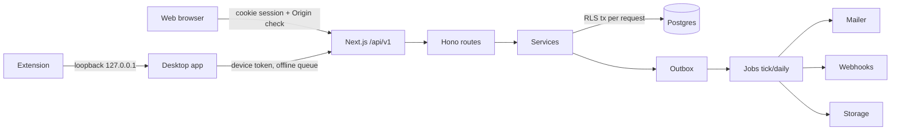

# WorkPulse full project audit (2026-10-16)

Scope: the whole monorepo at commit `3590891` (branch `feat/audit-polish-setup`, which is `main` plus PR #22).

Method:
- **Static review.** Six read-only reviewers covered security, backend and data, web pages (three slices), and desktop, integrations and ops.
- **Automated checks.** The project's own commands were run and their output observed.
- **Runtime reproduction.** The highest-risk findings were reproduced against the isolated E2E server (in-memory database, no email or storage, port 3100). No shared, staging or production environment was touched.

No source code was changed during the audit.

Verification labels used below:

| Label | Meaning |
|---|---|
| **Runtime** | Reproduced against a running server in this audit |
| **Traced** | Code path followed end to end; not executed |
| **Potential** | Plausible from the code; needs a runtime check |

---

## A. Executive summary

**Overall health: good foundation, with a short list of serious defects.** These are the strengths:
- The test suites are broad and green.
- Tenant isolation is layered: forced RLS plus app-level scope checks.
- Authentication is careful: hashed session tokens, argon2id, TOTP replay protection, PKCE for the desktop, refresh-token reuse detection.
- The Electron app is hardened.
- Webhooks have a real SSRF guard.
- Invoicing and payments are race-safe.

**Critical blockers before wider production use.** Items 1 to 3 were reproduced at runtime:

1. **A custom role with `members:manage` can make itself System Admin** (SEC-1, Runtime).
2. **Manual time can overlap a running timer, and the time is counted twice** (BE-3, Runtime). This flows into billing, invoices and payroll.
3. **Open redirect after login** via `?next=/%5Cevil.example` (SEC-4, Runtime).
4. **Payroll is not tied to the approved time it pays.** Time approved after a run is finalized is never paid, and overlapping runs can pay the same days twice (BE-1, BE-2, Traced).
5. **Desktop sign-out keeps the offline queue.** The next account to sign in on that machine sends the previous worker's events (DT-1, Traced).
6. **"Require device approval" is not enforced by the API** (SEC-2, Traced).
7. **Every notification email links to a 404**: the `/o/{orgId}` prefix is missing (INT-2, Traced).
8. **Next.js 16.3.6 has published advisories, including high severity.** The patch is 16.3.8.

**Highest-risk areas:**
- payroll ↔ timesheet linkage;
- role assignment;
- desktop offline and sign-out lifecycle;
- background jobs (one failure stops every tenant);
- mobile layouts in finance (action buttons disappear).

**Readiness:**
- Development and testing: ready.
- Staging or pilot with trusted admins: acceptable once items 1 to 3 and 7 are fixed.
- General production (multiple customers, real payroll): not until all eight blockers are fixed and the release pipeline is hardened (OPS-2).

No numeric quality score is given; there is no agreed method for one.

---

## B. Architecture

| Layer | Technology | Responsibility |
|---|---|---|
| `apps/web` | Next.js 16 App Router, React Query, `@tallywork/ui` | Admin and manager web app, client portal, auth pages; serves the API at `/api/v1` |
| `packages/api` | Hono | All business logic: routes → services; RLS transaction per request (`middleware/tenant.ts`) |
| `packages/db` | Drizzle, Postgres (PGlite locally and in tests), RLS (`tallywork_app` role, FORCE RLS) | Schema, 20 additive migrations, seed |
| `packages/contracts` | zod | Request and response contracts shared by web, desktop and API |
| `packages/domain` | TypeScript | Pure rules: pay, rounding, invoice status, periods, policy |
| `apps/desktop` | Electron (main / preload / renderer) | Time tracker: timer, activity, screenshots, offline queue, pay stubs |
| `apps/extension` | MV3 extension | Sends the active tab URL to the desktop's loopback bridge |
| Jobs | `packages/api/src/jobs` | Every-minute tick (session sweep, alerts, reminders, outbox, webhooks, report runs) and daily job (retention, accruals, digests, overdue invoices) |
| Integrations | Resend or SMTP mail; Supabase, Vercel Blob or local file storage; webhooks | No payment gateway, accounting, calendar or AI integration exists |
| CI/CD | GitHub Actions (`ci.yml`, `desktop-release.yml`, `desktop-linux-smoke.yml`); Vercel deploy runs migrations in `vercel-build` | |

**Architectural concerns:**
- **Side effects inside transactions.** Email and storage side effects run inside database transactions (BE-8, INT-1, BE-22).
- **Jobs.** They have no per-tenant error isolation (BE-7).
- **Mutations.** `useOrgMutation` refetches every org query by default and has no default error handling.

---

## C. Feature inventory

How each feature's status was established:
- **Verified (tests)**: Vitest or E2E tests exercise the feature, and they passed in this audit.
- **Implemented, unverified**: code exists, but no test drives the user flow.
- **Defects**: findings from section E that affect the feature.

| Feature | Main files | Status | Defects |
|---|---|---|---|
| Signup, login, logout, 2FA, password reset, email verification | `routes/auth.ts`, `services/identity.ts`, `mfa.ts`, `app/(auth)/*` | Verified (tests: `auth.spec`, `security.test`, `email-verification.test`) | SEC-4, SEC-9, SEC-11, FE-C2, FE-C14 |
| Organizations, setup checklist | `services/org.ts`, `app/o/[orgId]/page.tsx` | Verified (`organizations.spec`, `new-organization.test`) | FE-1, FE-C3/4/5 |
| Members, invitations, roles | `services/org.ts`, `workers/*`, `settings/roles` | Verified (`invitations.spec`, `profiles.spec`, `access-consistency.test`) | **SEC-1**, FE-C20/21 |
| Teams | `services/work.ts`, `teams/*` | Implemented, unverified (no E2E) | SEC-7, FE-C18 |
| Clients, projects, tasks, documents | `services/work.ts`, `project-documents.ts` | API verified (`clients.test`, `projects-details.test`); UI partly | BE-6, SEC-5, FE-B5, FE-B12 |
| Web timer, live tracking, sessions | `services/timer.ts`, `tracking.ts`, `timer-bar.tsx` | API verified (`tracking.test`) | **BE-3**, BE-4, FE-A2 |
| Activity, screenshots, apps and URLs | `services/activity.ts` | API verified; UI unverified | DT-6, DT-7 |
| Time entries, manual time, timesheets, approvals | `services/timesheets.ts`, `timesheets/*` | Verified (`timesheet*.test`, `time-entries.spec`, `time-rules.spec`) | BE-3, FE-A1, FE-A3, FE-A4, FE-A5 |
| Attendance, schedules, time off | `services/operations.ts` | API verified (`ops.test`, `workforce.test`); **no E2E** | BE-9, BE-14 |
| Rates, budgets, expenses | `services/finance.ts` | Verified (`budgets.spec`, `finance.test`); expenses UI has no E2E | BE-10, BE-15, FE-B1 |
| Invoices and payments | `services/finance.ts`, `finance/invoices/*` | Verified (`invoices.spec`, `finance-paging.*`) | **BE-5**, BE-12, FE-B2, FE-B11 |
| Payroll and pay stubs | `services/payroll.ts` | Verified (`payroll.spec`, `payroll.test`, desktop `pay-stubs.spec`) | **BE-1**, **BE-2**, BE-21 |
| Insights, dashboard, reports, exports | `services/insights.ts`, `reports.ts`, `report-runs.ts` | Verified (`insights.spec`, `reports.test`, `dashboard.test`) | BE-16 |
| Tracking policies | `services/policies.ts`, `settings/policies` | API verified; **no E2E** | SEC-6, FE-C6, FE-C7 |
| Security settings, retention, access review, audit log | `services/platform.ts`, `retention.ts` | API verified (`compliance.test`); UI unverified | INT-5 |
| API keys, webhooks | `services/platform.ts`, `integrations.ts` | API verified (`integrations.test`); **no E2E** | FE-C8 |
| Integration framework (sync providers) | `services/integrations.ts` | **Backend only**: no provider registered, no UI | — |
| Client portal | `services/portal*.ts`, `app/portal*` | API verified (`portal.test`); **no E2E** | FE-B3, FE-B4 |
| Support console and support access | `services/support.ts` | API verified (`support.test`) | SEC-3 |
| Notifications (in-app and email), digests, reminders | `services/notify.ts`, `digest.ts`, `reminders.ts` | In-app verified; email links **broken** (INT-2); digest and reminders unverified | INT-1, BE-8 |
| Desktop sign-in, sign-out, pay stubs, navigation | `apps/desktop` | Verified (Electron E2E, desktop specs) | DT-1, DT-10 |
| Desktop timer, idle, recovery, screenshots, offline queue | `apps/desktop/src/main/services` | Queue and IPC unit-tested; **user flow unverified** | DT-2, DT-3, DT-4 |
| Device approval | `services/agent.ts` | **Broken**: the setting is not enforced | SEC-2 |
| Minimum agent version (`MIN_AGENT_VERSION`) | `config.ts` | **Documented, not implemented** | DT-8 |
| Policy acknowledgement (`/agent/policy/ack`) | `routes/agent.ts` | Obsolete by design: no caller since desktop 0.1.5 | DT-9 |
| `idempotency_keys` table, `/idle-events`, `/tracking/note` | — | Unused by web and desktop (API only, or dead) | BE-20 |
| Browser extension | `apps/extension` | Bridge unit-tested; not published to a store | — |

---

## D. User flow audit

Notation: ✅ link in the chain verified; ⚠️ defect found.

1. **Owner onboarding:** signup ✅ → org created ✅ → Overview + setup checklist ✅ → invite ✅ → member accepts ✅.
   - ⚠️ Signup skips `/welcome`, where the time zone and currency are chosen; the currency is hard-coded to USD.
   - ⚠️ Invite links can't be recovered once the dialog is closed.
   - ⚠️ The checklist disappears for good if any of its queries fails.
2. **Worker tracking:** desktop sign-in ✅ → timer ✅ (API) → offline queue ✅ → ingest ✅.
   - ⚠️ Can't start offline after a restart (DT-3).
   - ⚠️ Monitors aren't restarted after re-sign-in (DT-4).
   - ⚠️ The last partial minute of activity is dropped (DT-2).
   - ⚠️ Sign-out mixes queues between accounts (DT-1).
3. **Time to pay:** entries ✅ → submit ✅ → approve ✅ → payroll run ✅ → finalize ✅ → pay stub ✅.
   - ⚠️ Late approvals are never paid (BE-1).
   - ⚠️ Manual time overlapping tracked time is double-paid (BE-3).
   - ⚠️ Overlapping runs (BE-2).
4. **Time to invoice to payment:** rates ✅ → approve ✅ → invoice preview and create ✅ → send ✅ → payment ✅.
   - ⚠️ Duplicate payment reference returns 500 (BE-5).
   - ⚠️ A deleted draft still shows in the list (FE-B2).
   - ⚠️ Action buttons are hidden on phones (FE-B1).
5. **Time off:** request ✅ → approve ✅ → balance ✅.
   - ⚠️ A worker can cancel approved leave after taking it (BE-9).
   - ⚠️ No E2E coverage.
6. **Notifications:** event ✅ → in-app row ✅ → in-app link ✅ → email ⚠️ (link 404, INT-2).
   - ⚠️ Workers whose notifications link to web pages are redirected to `/download` (prior audit §10.1, still open).
7. **Login return path:** `?next=` ✅ for same-origin paths. ⚠️ Backslash bypass (SEC-4).

**Flows with no E2E test:**
- time off;
- approvals queue;
- expenses (beyond paging);
- report run and export;
- tracking policies;
- roles;
- webhooks and API keys;
- schedules;
- client portal;
- desktop timer and idle.

---

## E. Findings register

Severity reflects the impact as configured today. IDs keep the prefix of the review that found them (SEC security, BE backend, FE web, DT desktop, INT integrations, OPS ops).

### High

**SEC-1: Custom role with `members:manage` can promote itself to System Admin.** Runtime.
- **Where:**
  - `packages/api/src/services/org.ts:283-312` (`updateWorker`): `role_id` is only checked for existence and that it is not AGENT.
  - `inviteWorker` (`org.ts:419-422`) has the same gap.
- **Reproduced:**
  1. The owner creates a role `{members:read: own, members:manage: own}`.
  2. The holder sends `PATCH /workers/{self} {role_id: SYSTEM_ADMIN}` and gets **200**.
  3. They can then read API keys (200).
- **Impact:** full takeover of the org: payroll, bank details, API keys. Built-in roles are not affected, because only System Admin has `members:manage`.
- **Fix:**
  - Add `assertCanAssignRole`: every grant in the target role must be ≤ the actor's own grants (the rule `upsertRole` already uses).
  - Forbid changing your own role unless you are the owner.
  - Enforce the scope of `members:manage` in update, remove and data export.
- **Test:** `security.test.ts`: self-promotion → 403; inviting with a higher role → 403; team-scope manager can't change someone outside the team.

**BE-3: Manual time can overlap a running timer, so the time is counted twice.** Runtime.
- **Where:** `services/timesheets.ts:381-399, 465-489` only check saved entries; the live segment isn't an entry yet.
- **Reproduced:**
  1. Start the timer.
  2. Add manual time inside the running interval → **201**.
  3. Stop the timer.
  4. Result: a 75 s tracked entry plus a 61 s manual entry over the same minute.
- **Impact:** double billing and double pay.
- **Fix:** treat the open WORK segment as busy in `assertNoOverlap` and `freeSlot`. Later, add an exclusion constraint.
- **Test:** `tracking.test.ts`: manual time during a running timer → 422 `time_overlap`.

**BE-1: Payroll isn't linked to the approved time it pays.** Traced.
- **Where:** `services/payroll.ts:231-238` selects billing entries by date only; `:311`; `timesheets.ts:820-824`.
- **Repro:**
  1. Finalize week W while A's timesheet is still submitted.
  2. Approve it.
  3. Next run → A's week W time is in no run.
  - Also: reopening an approved timesheet whose period is in a paid run is allowed, and nothing flags the difference.
- **Fix:**
  - Add `payroll_line_id` on `billing_entries`, set it at finalize.
  - Compute runs from unpaid entries with `local_date <= period_end`.
  - Block reopen for entries already paid.
- **Test:** `payroll.test.ts`: late approval lands in the next run; reopening a paid period → 422.

**BE-2: Overlapping payroll runs can pay the same days twice.** Traced.
- **Where:** `payroll.ts:311`, `0014_payroll.sql:62`. Duplicates are only detected on an exact profile and start date.
- **Repro:** change a pay group's period, or move a member between pay groups.
- **Fix:** BE-1's link fixes this structurally. Until then, refuse runs that overlap non-draft runs for the same members.

**SEC-4: Open redirect after login.** Runtime.
- **Where:** `apps/web/app/(auth)/login/page.tsx:34` only checks `startsWith('/') && !startsWith('//')`.
- **Reproduced:** sign in at `/login?next=%2F%5Cevil.example%2Fphish` → the browser navigates to `http://evil.example/phish`.
- **Fix:**
  - Use `const u = new URL(next, location.origin)`.
  - Navigate only when `u.origin === location.origin`, and only to `u.pathname + u.search + u.hash`.
- **Test:** `e2e/tests/web/auth.spec.ts`: a backslash `next` stays on the app origin.

**SEC-2 / DT-5: "Require device approval" is not enforced.** Traced.
- **Where:** `services/agent.ts:112, 172, 198`: PENDING devices get working tokens; only REVOKED is rejected.
- **Impact:** an unapproved machine can submit time and screenshots and download pay stubs.
- **Fix:**
  - `loadAgentCtx` rejects PENDING with `403 device_pending`, except for bootstrap and heartbeat.
  - The desktop shows a "waiting for approval" state.
- **Test:** `agent.test.ts`: pending device → 403 on ingest, `/me/pay-stubs` and upload-intent; after approval → 200.

**DT-1: Desktop sign-out leaves the offline queue for the next account.** Traced.
- **Where:** `apps/desktop/src/main/services/agent.ts:182-189`. `sync()` returns immediately when offline; `queue.log`, `manual-requests` and `last-project` persist.
- **Impact:** user B's sign-in sends user A's sessions and manual-time requests as B.
- **Fix:**
  - Stamp queued events with the device and membership.
  - Refuse to send them under other credentials.
  - Drain before sign-out, or warn that unsent time will be lost.
  - Clear the per-user files.
- **Test:** an agent unit test with a fake store.

**INT-2: Notification emails link to a 404.** Traced.
- **Where:** `packages/api/src/services/notify.ts:30` builds `${appUrl}${n.link}`, but links are org-relative (`/timesheets/approvals`). `reminders.ts:107` shows the right form: `/o/${org.id}`.
- **Fix:** prefix `/o/${organizationId}`.
- **Test:** a MemoryMailer assertion on the link.

**DEP-1: Vulnerable dependencies.** Runtime (`pnpm audit --prod`): 22 advisories (1 critical, 12 high, 8 moderate, 1 low).

| Package | Advisories | Path | Fix |
|---|---|---|---|
| `next` 16.3.6 | 6, including high severity | `apps/web` | Upgrade to ≥ 16.3.8 |
| `tar` | 12, including the critical one | Build-time only: `apps/desktop > get-windows > node-pre-gyp` | Override or upgrade |
| `sharp`, `source-map-js`, `http-cache-semantics` (high); `uuid` (moderate) | 1 each | Via `next`; `uuid` via `exceljs` | Follow the parent upgrades |

**FE-B1: Phone layout of `DataTable` drops the actions column.** Traced.
- **Where:** `packages/ui/src/table.tsx:268-292`.
- **Impact:** below `md` width you can't:
  - approve, reject or reimburse expenses;
  - delete rates or payments;
  - adjust payroll or download a stub;
  - open bank details or the client, project or task menus.
- The clickable phone row is a `div role=button` with no keyboard handler.
- **Fix:** always render `actions` in the card, and add Enter/Space handling.
- **Test:** an E2E at a 390 px viewport.

### Medium

**Security**

| ID | Title | Where | Status | Fix |
|---|---|---|---|---|
| SEC-3 | Support console is granted by email match while email verification is off by default, so someone can pre-register a staff address | `services/support.ts:33-38`, `config.ts:30` | Potential (config) | Require `emailVerifiedAt`; default verification on in production |
| SEC-8 / INT-6 | With no mailer configured in production, full email bodies, including reset tokens, go to the logs; forgot-password returns 500 for existing emails if the provider fails (enumeration) | `lib/mailer.ts:20-23,83`, `routes/auth.ts:115-123` | Traced | Log only `to` and `subject`; fail fast in production; catch send errors |
| SEC-6 | Policy layers ignore scope: a worker can read other workers' and teams' layers; a team-scope manager can write the ORG layer | `services/platform.ts:118-126` | Traced | Scope checks per layer type |

**Backend and money**

| ID | Title | Where | Status | Fix |
|---|---|---|---|---|
| BE-5 | Payment `provider_ref` is unique across all organizations: the second org gets **500**, and tenants can block each other | `db/schema/finance.ts:273`, `0000_init.sql:1147` | **Runtime** | Make the unique index per organization; map 23505 → 409 |
| BE-11 | Malformed IDs return **500** (payroll runs, expense approve, timesheet history, pay stubs); invoices correctly return 404 | `lib/http.ts` `problemFromError` | **Runtime** | Map 22P02 → 404 and 23505 → 409 globally |
| BE-6 | `PATCH /clients/:id` clears every field that isn't sent; a currency change strands uninvoiced time | `services/work.ts:130-152` | Traced | Partial update; refuse currency change with uninvoiced entries |
| BE-4 | Two concurrent `/tracking/switch` calls can create duplicate entries | `timer.ts:98-104`, `tracking.ts:66-73` | Traced (race) | `lockWorker` first; `ended_at is null` guard |
| BE-9 | A worker can cancel approved time off after taking it, which restores the balance even if it was paid | `operations.ts:465-475` | Traced | Only approvers cancel once the start date has passed |
| BE-8 / INT-1 | Emails are sent inside transactions and at-least-once handlers: duplicates on retry, sent despite rollback; Resend has no timeout | `notify.ts:30`, `finance.ts` `sendInvoice`, `digest.ts`, `mailer.ts:34` | Traced | Send after commit through the outbox with a dedup key; `AbortSignal.timeout` |

**Jobs and integrations**

| ID | Title | Where | Status | Fix |
|---|---|---|---|---|
| BE-7 / INT-3 | One failing org or session aborts the whole tick or daily job for every tenant | `jobs/index.ts` (≈201-316) | Traced | Per-item try/catch; independent stages; last-success gauges |
| INT-5 | Retention deletes database rows even when deleting the stored file failed, leaving orphaned screenshots | `retention.ts:119` | Traced | Delete only rows whose file deletion succeeded; retry the failures |

**Desktop**

| ID | Title | Where | Status | Fix |
|---|---|---|---|---|
| DT-2 | The last partial minute of activity is dropped on every stop, pause, idle and suspend | `monitors.ts` `stop()`, `agent.ts:386-391` | Traced | Keep or enqueue the drained bucket |
| DT-3 | Can't start the timer offline after a restart; the app stays on Loading | `agent.ts:41-54,201`, `App.tsx:19` | Traced | Persist the last bootstrap (encrypted) and show an offline banner |
| DT-4 | After re-sign-in a running session continues with no monitors, so the policy isn't enforced | `agent.ts:105-111,620-633` | Traced | Stop the session on sign-out, or restart monitors after bootstrap |
| DT-6 | Screenshot blur isn't enforced by the server; policy changes reach the desktop with up to ~5 min lag | `services/agent.ts` `screenshot.captured`; desktop `agent.ts:605-614` | Traced | Reject unblurred uploads when blur is required; refresh on a heartbeat hash change |
| DT-7 | A worker can overwrite their own past screenshots (overwrite allowed, no existence check, no rate limit) | `lib/storage.ts:49-51,146-155`, `routes/agent.ts` ≈56 | Potential | Refuse an intent for an existing ID; no overwrite or upsert |
| DT-8 | `MIN_AGENT_VERSION` is documented as enforced but nothing checks it | `config.ts:28` | Traced | 426 on heartbeat and ingest; the desktop prompts to update |

**Ops**

| ID | Title | Where | Status | Fix |
|---|---|---|---|---|
| OPS-1 | Missing `CRON_SECRET` in production silently disables the daily job (retention, accruals, digests, overdue invoices) | `config.ts:27` | Traced | Fail at startup in production |
| OPS-2 | Desktop release pipeline: dispatchable from any ref, no tests before publishing to the auto-update feed, unsigned builds, `--latest` without staging, no `permissions:` | `.github/workflows/desktop-release.yml` | Traced | Restrict to main or tags; tests as `needs`; gate on all platforms; signing |
| OPS-3 | Packaged desktops point at the manual alias `tallywork-alpha.vercel.app`, which production deploys don't move | `apps/desktop/src/main/index.ts:10` | Traced | Make it a project domain |
| OPS-4 | The restore runbook says desktops replay data after a restore, but they delete acknowledged events | `docs/ops/runbooks.md` | Traced | Correct the RPO statement |

**Web**

| ID | Title | Where | Status | Fix |
|---|---|---|---|---|
| FE-A1 | All entries keeps the selection when filters or page change; bulk actions hit hidden rows, and more than 200 fails with 422 | `timesheets/all/page.tsx:300,348,565` | Traced | Clear the selection on filter or page change |
| FE-A2 | The web timer can't start on phones: the project picker is hidden below `sm` | `components/shell/timer-bar.tsx:78,131` | Traced | Compact picker or popover |
| FE-A3 | All entries offers Add time on locked or submitted days | `timesheets/all/page.tsx:250,373,397` | Traced | Check the period status |
| FE-A4 | Manual-time list scoped by `time:read`, not `manual_time:approve` | `services/timesheets.ts:525` | Traced | Scope by the approve permission |
| FE-4 | Entry dialogs use the browser time zone while lists use the member's | `entry-dialogs.tsx:109,419`, `csv-import.tsx:76` | Traced | Enter times in the member's time zone and name it |
| FE-B2 | A deleted invoice draft still shows in the list (`invalidate:false`, 15 s stale) | `finance/invoices/[id]/page.tsx:40` | Traced | Invalidate the invoice lists |
| FE-B3 | Client portal is stuck after an invalid date range: the error replaces the date inputs | `portal-dashboard.tsx:42`, `portal/[accessId]/page.tsx:22-28` | Traced | Validate the range; keep the inputs visible |
| FE-B4 | Portal invite shows nothing on token or name validation errors | `app/portal-invite/page.tsx:40` | Traced | Show the title; guard a missing token |
| FE-C2 | Signup hides errors for organization name and time zone (no `maxLength`) | `app/(auth)/signup/page.tsx:79` | Traced | Field errors plus a fallback title |
| FE-C3/4/5 | Overview: a failed data request shows "no access"; no layout loading or error state; Save and Reset can double-submit | `app/o/[orgId]/page.tsx:83,177,197,225` | Traced | ErrorState; pending states |
| FE-C6/7 | Policies: switching team or member silently discards edits; an invalid number field still saves the old value | `settings/policies/page.tsx:73,104-124,278` | Traced | Confirm dialog; block save while invalid |
| FE-C8 | Webhook secret rotation has no confirmation or pending guard | `developer/webhooks/page.tsx:99,164` | Traced | ConfirmDialog |
| FE-1 | The setup checklist hides for good if any of its queries fails | `components/workspace/setup-checklist.tsx:54` | Traced | Skip the failed step instead |

### Low and informational

**Security**
- SEC-5: `/files/:id` has no branch for project documents. Deny by default.
- SEC-7: a team-scope `teams:manage` role can pull anyone into its team.
- SEC-9: changing your password keeps other sessions alive and has no rate limit.
- SEC-10: desktop 2FA guesses are limited only per IP.
- SEC-11: login and signup accept cross-site `text/plain` POSTs (login CSRF).
- SEC-12: rate-limit IP taken from `x-forwarded-for`; reuse `clientIp()`.
- SEC-13: no CSP on the web app.
- SEC-14:
  - email and invite tokens are not consumed atomically;
  - a fixed `APP_SECRET` is used outside production;
  - Drizzle error messages (with parameters) are logged;
  - bank details can be changed without 2FA re-auth or a notification.

**Backend**
- BE-10: amounts in different currencies are summed under the org currency (amounts owed, MONEY budgets).
- BE-12 (invoices):
  - `due < issue` is accepted on create;
  - `quantity` is unbounded (overflow → 500);
  - a zero-total sent invoice can never be paid;
  - `/100` is assumed for every currency.
- BE-13: deleting a missing budget, holiday or team returns 204.
- BE-14: time-off requests and accruals are not serialized (possible overdraw or double accrual).
- BE-15: budget checks run on every `time.changed` with N+1 queries; no `(org, project, date)` rollup index.
- BE-16: report runs stuck in RUNNING are never recovered.
- BE-17: financial tables have no foreign keys or CHECK constraints; `rateInput.scope_id` is free text.
- BE-18: the system idle-discard can edit approved or billed entries.
- BE-19: changing the pay period leaves mismatched timesheet rows.
- BE-20: `idempotency_keys` is unused, so retried POSTs duplicate payments and expenses.
- BE-21: weekly overtime is split at period edges (informational; overtime isn't priced).
- BE-22: storage is deleted before the transaction commits.

**Desktop and integrations**
- DT-9: `/agent/policy/ack` is unused (a product decision).
- DT-10:
  - sign-out doesn't revoke the device on the server;
  - no grace window on refresh-token reuse;
  - `quit()` can hang;
  - the Schedule week ignores `weekStart`.
- INT-4: the cron tick bypasses the lease; duplicate long-break alerts; a hot `job:tick` row upsert on every request.
- INT-7: the live-stream cursor can skip events.

**Ops**
- OPS-5: the crash-free SLO can't be measured; no error reporting service.
- OPS-6: stale Upstash variables in `turbo.json`; mail variables missing from it.
- OPS-7: **no lint is configured.** `pnpm lint` runs 0 tasks, so the hooks, keys and accessibility rules a linter would catch are not enforced.

**Web**
- FE-3: hard-coded locales and browser `toLocaleString`. Files: `people/shared.tsx`, `timesheets/shared.tsx`, `reports/format.tsx`, `settings/audit`, `settings/security`, `portal-dashboard`, `sessions/page.tsx:304`.
- FE-5: the portal preview range is computed in UTC.
- FE-6: raw hex colours.
- FE-7: the last-used org is only stored on Overview.
- FE-A6 to FE-A18:
  - missing client validation (end before start, required reasons);
  - the history drawer shows raw IDs for time types and actors;
  - Save as report drops the task and search filters;
  - All entries uses the org time zone for "today";
  - the notification preference uses the wrong permission (`budgets:read` for late time);
  - ignored errors on pay stubs and schedules;
  - time-off bulk approve sends one request per item;
  - the Profile device list shows raw platform values.
- FE-B5 to FE-B13:
  - the Projects list shows $0.00 for hidden budgets;
  - payroll actions aren't disabled while busy;
  - the payment currency is guessed from the first invoice;
  - amounts owed mix currencies;
  - the budget dialog pre-fills a hidden amount as 0.00;
  - Create invoice can double-submit;
  - the Tasks filter markup is misplaced;
  - "discounts" are suggested but negative prices are rejected.
- FE-C12 to FE-C23:
  - raw error text on the invite page;
  - a wrong message when email resend fails;
  - forgot-password swallows 429;
  - wrong empty-state copy on access review;
  - possible duplicate React keys on the support page;
  - Teams counts archived projects;
  - links shown that lead to 403;
  - Enter can double-submit the invite;
  - no confirmation when shortening retention;
  - the `weekly_limits` widget shows "Coming soon".

---

## F. Test results (executed in this audit)

| Command | Result |
|---|---|
| `pnpm typecheck` | **Pass** (all workspaces, 7 s) |
| `pnpm lint` | **No lint configured**: 0 tasks ran (OPS-7) |
| `pnpm test` (Vitest) | **Pass**: 7 of 7 packages. api 414 passed + 1 skipped (the latency test, which runs alone in CI); domain 55; desktop 34; web 21; ui 11; db 6 |
| `pnpm audit --prod` | **22 advisories** (DEP-1) |
| `pnpm build` | **Pass** (web + desktop, 80 s) |
| `pnpm test:e2e` | **Pass**: 82 of 82 (web, desktop renderer, Electron) |
| Runtime reproductions (isolated server) | SEC-1 **reproduced**; SEC-4 **reproduced**; BE-3 **reproduced**; BE-5 **reproduced**; BE-11 **reproduced** (4 routes) |
| PR #22 CI | All 9 checks pass. An Electron pay-stub test race was found and fixed in the test (`3590891`); assertions unchanged |

**Not executed, and why:**
- **Desktop runtime flows** (timer, idle, offline restart, screenshots, auto-update) need an interactive desktop session; no E2E drives them yet.
- **Production configuration** (mailer, `CRON_SECRET`, `REQUIRE_EMAIL_VERIFICATION`, `SUPPORT_STAFF_EMAILS`, Supabase PITR, the Vercel cron plan) needs dashboard access; it was deliberately not inspected.
- **Concurrency races** (BE-4, BE-14) and query plans (BE-15) were not load-tested; no staging database exists for `load/`.
- **Device approval** (SEC-2) and the email link (INT-2) were confirmed by code trace only.

---

## G. Security summary

**Verified by reproduction:**
- SEC-1 (privilege escalation);
- SEC-4 (open redirect);
- BE-5 (cross-tenant uniqueness collision, which also leaks that another tenant used the reference).

**Confirmed by trace:**
- SEC-2 (device approval);
- SEC-6 (policy scope);
- SEC-8 (tokens in logs when no mailer is configured);
- SEC-9 (sessions kept after a password change);
- DT-1 (cross-account queue).

**Potential:**
- SEC-3, SEC-11, SEC-12, DT-7.

**Sound:**
- **Sessions:** hashed, httpOnly, Secure, SameSite cookies; Origin check on cookie mutations; no CORS.
- **Tenant isolation:** FORCE RLS plus a non-member → 404 rule.
- **Credentials:** argon2id with dummy-hash timing; TOTP replay protection; encrypted secrets.
- **API keys:** scoped allow-lists.
- **Desktop sign-in:** PKCE with refresh rotation.
- **Injection:** `sql.raw` only behind allow-lists; escaped `ILIKE`; CSV formula guard.
- **Outbound:** SSRF guard with a connect-time DNS check.
- **Uploads:** allow-lists for type and size.
- **Electron:** contextIsolation, sandbox, zod-validated IPC.
- **Extension:** minimal permissions.
- **Secrets:** none tracked in git.

---

## H. Missing and incomplete features

**Not enforced or not implemented:**
- Device approval (not enforced).
- `MIN_AGENT_VERSION` (not implemented).
- Integration sync framework (backend only: no provider, no UI).
- `idempotency_keys` (table only).

**Unused endpoints:**
- `/agent/policy/ack`, `/idle-events`, `/tracking/note`: unused by both apps.

**Product gaps:**
- Payroll missing-rate warning: not built.
- Project effective-rate display: not built.
- Currency choice at signup: hard-coded USD; `/welcome` is skipped.
- Worker web access: workers are sent to `/download`, yet receive web links.

**Tests and tooling:**
- No E2E coverage: time off, approvals, expenses, reports, policies, roles, developer settings, schedules, portal, desktop timer.
- No lint configuration.
- No error-reporting service.
- No staging environment for load tests.

---

## I. Prioritized remediation plan

| Priority | Item | Effort | Depends on |
|---|---|---|---|
| **Immediate** | SEC-1 role assignment bound | S | — |
| Immediate | SEC-4 same-origin `next` | S | — |
| Immediate | BE-3 live segment counts as busy | S | — |
| Immediate | INT-2 email links `/o/{org}` | S | — |
| Immediate | DEP-1 upgrade `next` to ≥ 16.3.8, override `tar` | S | Full E2E rerun |
| Immediate | SEC-2 enforce device approval (API + desktop waiting state) | M | Desktop release |
| Immediate | DT-1 bind the offline queue to its account | M | Desktop release |
| Immediate | BE-1 + BE-2 link payroll lines to billing entries | L | Migration; payroll tests |
| **High** | BE-5 per-org payment ref + BE-11 error mapping (22P02 / 23505) | S | Migration |
| High | FE-B1 actions on phones | S | — |
| High | SEC-8 / OPS-1 fail fast on missing mailer or `CRON_SECRET` in production | S | Env check |
| High | BE-7 per-tenant job isolation | M | — |
| High | BE-8 send email after commit | M | Outbox |
| High | DT-2 / DT-3 / DT-4 desktop activity and offline fixes | M | Desktop release |
| High | DT-6 server-side blur | S | — |
| High | OPS-2 release pipeline gates | M | — |
| High | OPS-3 desktop API domain | S | Vercel domain |
| High | BE-6 client partial update | S | — |
| High | BE-9 cancel after start | S | — |
| **Medium** | SEC-3, SEC-6, SEC-9 | S each | — |
| Medium | INT-5 retention | S | — |
| Medium | DT-7 screenshot overwrite | S | — |
| Medium | DT-8 minimum version | M | Desktop |
| Medium | FE-A1 to FE-A4 | S each | — |
| Medium | FE-B2 to FE-B4 | S each | — |
| Medium | FE-C2 to FE-C8 | S each | — |
| Medium | FE-1, FE-4 | S / M | — |
| Medium | BE-4, BE-10, BE-12 to BE-16 | S–M | — |
| Medium | OPS-4 | S | — |
| Medium | Add E2E specs for the untested flows (section H) | M | — |
| **Low** | Locale and formatting cleanup (FE-3) | S | — |
| Low | Lint setup (OPS-7) | M | — |
| Low | CSP (SEC-13) | M | — |
| Low | Foreign keys and CHECKs (BE-17) | M | Migration |
| Low | Idempotency keys (BE-20) | M | — |
| Low | Remaining Low items in section E | S | — |

---

## J. Release verification checklist

- [ ] Self-promotion and higher-role invite → 403 (`security.test`)
- [ ] `next` backslash and tab variants stay on origin (`auth.spec`)
- [ ] Manual time inside a running timer → 422 (`tracking.test`)
- [ ] Late approval after finalize appears in the next payroll run; reopening a paid period → 422 (`payroll.test`)
- [ ] Pending device → 403 on ingest, pay stubs and upload-intent (`agent.test`)
- [ ] Desktop sign-out with a queued event; a second account doesn't send it (desktop unit test)
- [ ] Email notification link contains `/o/{orgId}` (`mailer` / `notify` test)
- [ ] Same payment ref in two orgs → both 201; malformed IDs → 404 (`finance.test`)
- [ ] `pnpm audit --prod` shows no high or critical advisories in runtime dependencies
- [ ] Expenses, payroll and payments usable at a 390 px viewport (E2E)
- [ ] New E2E specs: time off, approvals queue, expenses approve and reimburse, report export, tracking policies, roles, webhooks, portal
- [ ] `pnpm typecheck`, `pnpm test`, `pnpm test:e2e` green; CI green, including Electron

---

## K. User-experience and flow improvements

These are not defects. They are changes that would make the product easier to use, ordered by impact.

**Navigation and structure**
1. **One place for team time.** "All entries", "View & edit", "Approvals" and "Manual time" overlap.
   - Merge them into one pay-period queue: list, per-member drawer, approve, manual requests inline.
   - "View & edit" should follow pay periods, not calendar weeks (FE-A5).
   - The approvals queue should show pending manual-time requests.
2. **Workers on the web.** Workers are redirected to `/download`, yet their notifications link to web pages. Choose one:
   - deep-link notifications into the desktop app; or
   - give workers a small web area: my timesheet, pay stubs, what is monitored.
3. **One Settings area with tabs.** Organization, Policies, Roles, Security, Access review, Audit log and Developer are separate sidebar items today.
   - Move "What is monitored" out of Settings and into the profile menu.
4. **Rates in one editor.** Show the *effective* rate on the project page, not "Not set" when a client or org rate applies. Move "Amounts owed" into Payroll.

**Onboarding**
5. **Signup.** Pass through `/welcome` (time zone and currency) instead of hard-coding USD.
6. **Invitations.**
   - Show the organization name on the invite page.
   - Don't ask existing users for a new password.
   - Give pending invitations "Copy link" and "Resend".
7. **Setup checklist.** "Connect the desktop app" should link to the download page as well as Devices.
8. **Device page.** Offer a self-serve installer link; today it says "Ask your administrator for the installer".

**Everyday flows**
9. **Time zones.** Every time input should say which zone it uses, and default to the member's (FE-4).
10. **Mobile.**
    - Actions in table cards (FE-B1).
    - A project picker for the web timer (FE-A2).
    - Fewer fixed-width tables.
11. **Profile.**
    - Allow editing the name (the API already supports it).
    - Add "Resend verification" next to "Not verified".
12. **Payroll.**
    - Warn about members with no pay rate before finalizing.
    - Finish renaming "payroll profile" to "pay group" (4 places).
    - Disable all actions while one is running.
13. **Consistency.**
    - Reject comments should be required (or optional) the same way for time off, timesheets and manual time.
    - Bulk actions should report per-item failures everywhere, as approvals already does.
    - Use one `MultiSelect` and one `DateRangeFilter` component (two of each exist).
14. **Errors.**
    - Give `useOrgMutation` a default error toast, so a missing `onError` can't fail silently.
    - Overview should show an error state, not "You do not have access", when data fails to load.
15. **Projects form.** "Not billable project" is a double negative. Use "Billable" (checked by default).
