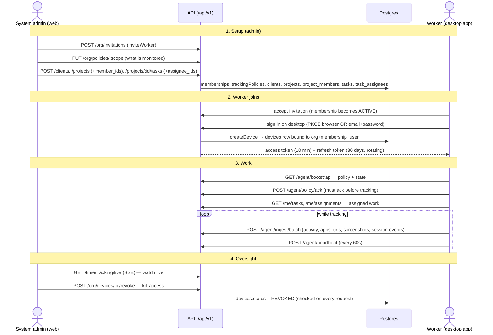

# How the desktop worker app and the system admin are connected

This document explains how the **worker's desktop app** (`apps/desktop`, an Electron app) and the
**system admin** (working in the web app, `apps/web`) are connected through the API
(`packages/api`), and the end-to-end flow from an admin setting things up to a worker tracking time
on their machine.

It is written for engineers working in this repo. It links to the code so you can read the detail;
line numbers drift, so treat function and file names as the source of truth.

- The product is **WorkPulse**; the code scope is `@tallywork/*`.
- The admin never talks to the desktop app directly. Everything flows through the server: the admin
  writes records (membership, policy, client/project/task) and manages devices; the desktop app
  reads and writes **only its own worker's data** through the `/agent/*` API, authenticated by a
  device credential.

---

## The actors

| Actor | Where | Identity | Talks to |
|---|---|---|---|
| System admin | Web app (`apps/web`) | User session (cookie) | `/api/v1/org/*`, `/api/v1/time/*` |
| Worker | Desktop app (`apps/desktop`) | **Device** access token (Bearer) | `/api/v1/agent/*` only |
| Server | `packages/api` (Hono) | — | Postgres (per-tenant tx) |

The whole relationship is anchored on one row: a **`devices`** record is bound to
`(organization, membership, user)`. The admin controls the membership and can revoke the device; the
desktop app can only ever act as the worker behind that membership.

---

## The full picture

---

## 1. Setup: what the admin does first

### a. Invite the worker (creates the membership the device binds to)

A worker must have an **ACTIVE membership** before a device can enroll.

- Admin: `POST /org/invitations` → `inviteWorker` ([org.ts](../packages/api/src/routes/org.ts)).
- Worker accepts → `acceptInvitation` in [identity.ts](../packages/api/src/services/identity.ts) creates
  the user (if new) and the `memberships` row.

The device credential is later bound to this `membership.id`.

### b. Set the monitoring policy (what the desktop app is allowed to collect)

- Admin: `PUT /org/policies/:scopeType/:scopeId` → `putPolicyLayer`
  ([platform.ts](../packages/api/src/services/platform.ts)). Layers exist at `ORG`, `TEAM` and
  `WORKER` scope, stored versioned in `trackingPolicies`.
- The effective policy for a worker merges those layers (`resolvePolicy` in `@tallywork/domain`,
  gathered by `effectivePolicy` in [policies.ts](../packages/api/src/services/policies.ts)).
- A **`policyHash`** (first 16 chars of a SHA-256 over a stable serialization) is the change-detection
  token the desktop app watches.
- Admin can preview a worker's effective policy: `GET /org/workers/:id/effective-policy`.

### c. Create the client → project → task and assign the worker

See the companion flow (clients/projects/tasks) — summarized here because it's what the worker
ultimately sees. All of this logic lives in [work.ts](../packages/api/src/services/work.ts).

1. **Client** — `POST /clients` → `upsertClient` (requires `clients:manage`).
2. **Project under the client** — `POST /projects` → `upsertProject` (requires `projects:manage`).
   The dialog's `member_ids`/`team_ids` write `project_members`/`project_teams`. **This is what lets
   the worker track time to the project** (`workerCanTrackProject`).
3. **Task under the project** — `POST /projects/:id/tasks` → `upsertTask` (requires `tasks:create`
   or `tasks:manage`). `assignee_ids` write `task_assignees`. **This is what makes the task appear as
   "assigned to you".**

There are two separate assignment layers — project membership (can track time) and task assignee
(appears as the worker's task); both are normally needed.

---

## 2. How the worker connects: enrollment and tokens

The desktop app has **two sign-in paths**, both ending in `createDevice`
([agent.ts](../packages/api/src/services/agent.ts)), which inserts a `devices` row bound to
`organization + membership + user` and issues tokens.

### Path A — PKCE via the system browser

1. Desktop opens a one-shot loopback server on `127.0.0.1:<random>` and launches the system browser
   to `/device/authorize` ([auth.ts](../apps/desktop/src/main/services/auth.ts)). Uses SHA-256 PKCE.
2. The web page [device/authorize/page.tsx](../apps/web/app/device/authorize/page.tsx) strictly
   validates the loopback redirect (RFC 8252), confirms the user is signed in, lets them pick an org,
   then calls `POST /agent/authorize` → returns a one-time `code`.
3. `POST /agent/authorize` → `createDeviceAuthCode` stores a hashed code + PKCE challenge, 10-min
   expiry.
4. Desktop exchanges the code via `POST /agent/register` → `registerDevice` verifies PKCE, marks the
   code used, calls `createDevice`.

### Path B — email + password

- `POST /agent/login` → `loginDevice`: runs the same web `login()` checks (lockout, email verified),
  MFA, then resolves active memberships. If the person belongs to several orgs and picked none, it
  returns `{ organization_required, organizations[] }` so the UI can prompt. The password is sent
  once and **never stored**.

### Device approval

`createDevice` sets the device `PENDING` if `org.settings.requireDeviceApproval` is on, otherwise
`ACTIVE`. A pending device can't track until an admin approves it.

### Tokens (`issueTokens`)

| Token | TTL | Storage | Notes |
|---|---|---|---|
| Access | 10 min | **In memory only** (desktop main process) | Stateless signed token; verified per request in [auth.ts](../packages/api/src/middleware/auth.ts). |
| Refresh | 30 days | Only its SHA-256 hash in `deviceCredentials`; the token itself stored OS-encrypted on the desktop | Rotates on use, within a `familyId`. |

**Rotation + theft detection** (`refreshDeviceToken`, `POST /agent/token`): if a refresh token that
was already used is presented again, the **entire token family is revoked** and
`device.token_reuse_detected` is audited.

**Desktop storage** ([secure-store.ts](../apps/desktop/src/main/services/secure-store.ts)): a random
256-bit data key is wrapped by the OS keychain via Electron `safeStorage` (DPAPI / Keychain /
libsecret); credentials and the offline queue are AES-256-GCM encrypted with it. On Linux with no
keyring the app refuses to start and explains why. The access token lives only in memory and is
re-minted from the refresh token.

---

## 3. The IPC bridge: why the renderer never sees tokens

The Electron **main** process holds all tokens and does all HTTP; the **renderer** (the worker's UI)
only speaks through a small, validated channel.

- **Channel contract**: [ipc.ts](../apps/desktop/src/shared/ipc.ts) — a Zod-validated allowlist of
  channel → schema. `AgentState` is the shape pushed to the renderer.
- **Preload**: [preload/index.ts](../apps/desktop/src/preload/index.ts) exposes a minimal typed
  bridge via `contextBridge`. No generic `invoke`, no `ipcRenderer`, no Node.
- **Main**: [main/index.ts](../apps/desktop/src/main/index.ts) `registerIpc` maps each channel to an
  `Agent` method; `ipcMain.handle` checks the sender is our own window and a trusted origin, then
  re-validates the payload with the Zod schema before dispatch. The window runs with
  `contextIsolation: true, nodeIntegration: false, sandbox: true`.
- **Token attachment**: all HTTP goes through main's `AgentApi`
  ([api.ts](../apps/desktop/src/main/services/api.ts)), which adds `Authorization: Bearer <access>`,
  refreshes on expiry, and on a `401` drops the cached access token and retries once. The pay-stub
  PDF, for example, is fetched in main precisely so the token never reaches the window.

---

## 4. Policy handshake and transparency gate

- The desktop app fetches policy in the **bootstrap** payload: `GET /agent/bootstrap` → `bootstrap`
  returns `policy`, `policy_hash`, `policy_acknowledged`. It's polled every ~5 min and re-checked
  whenever a sync/heartbeat returns a changed `policy_hash`.
- **Acknowledgement is required before tracking**: the desktop `start()` throws if the policy isn't
  acknowledged. The worker acks via `POST /agent/policy/ack`, which verifies the hash still matches
  and writes `policyAcks`. When the admin changes the policy, the worker is notified and must re-ack.
- **Policy is enforced twice**: client-side (which monitors start) and **server-side** in
  `processEvent` — activity/app/url/screenshot events are rejected if that signal is disabled by
  policy, and URL rules are re-applied on the server. So the server is the final authority on what is
  collected, not the client.

---

## 5. Data flow: desktop → server

Flow: monitors → in-memory buffer → **durable encrypted offline queue** → batch upload → server
state machine.

- **Monitors** ([monitors.ts](../apps/desktop/src/main/services/monitors.ts)): activity counts, active
  app, screenshots; website domains via `urls.ts`.
- **Offline queue** ([queue.ts](../apps/desktop/src/main/services/queue.ts)): append-only, AES-GCM
  encrypted, fsync'd before send, compacted on ack. This is what guarantees **no tracked time is lost**
  across crashes or outages.
- **Sync**: `POST /agent/ingest/batch` (up to ~200 events, with `sent_at` for clock-skew correction).
  The server `ingestBatch` de-dupes via ingest receipts, processes each event in a savepoint (one bad
  event can't abort the batch), returns per-event `accepted | duplicate | rejected`, and drives the
  session state machine. The response carries the authoritative session + `policy_hash`, which the
  desktop reconciles against.
- **Heartbeat**: `POST /agent/heartbeat` every 60s updates `devices.lastSeenAt` and the session's
  heartbeat. A lost heartbeat makes the server mark the session `INTERRUPTED`, recovered later on sync.
- **Screenshots** are a two-step upload: `POST /agent/screenshots/upload-intent` returns a
  direct-to-blob token (Vercel Blob / Supabase signed URL); the key is forced to an
  `org/<orgId>/screenshots/<membershipId>/…` prefix, and the later `screenshot.captured` event is
  validated against that prefix server-side. **Screenshots are never returned to a device.**
- Every `/agent/*` route is rate-limited and runs inside the device's per-tenant transaction.

---

## 6. What the worker sees (assigned work)

- `GET /me/tasks` → `myTasks` ([agent-me.ts](../packages/api/src/services/agent-me.ts)) runs
  `listTasks({ mine: true })`, filtered to tasks where the worker is in `task_assignees`. The device's
  grants are narrowed to an allowlist at `assigned` scope, so it can only ever read its own worker's
  data.
- Rendered in the desktop app by `TasksPage` ([Pages.tsx](../apps/desktop/src/renderer/src/Pages.tsx))
  — "Tasks assigned to you". `GET /me/assignments` feeds the Projects page. Tapping a task calls the
  bridge to `start(project_id, task_id)` and begins tracking against it.

---

## 7. Admin oversight and revocation

- **Devices**: [devices/page.tsx](../apps/web/app/o/[orgId]/devices/page.tsx) → `GET /org/devices`
  (`listDevices`). Actions: `POST /org/devices/:id/{revoke|approve|reauth}` → `setDeviceStatus`.
  Guarded by `devices:read` / `devices:manage`.
- **Live tracking**: [tracking/live/page.tsx](../apps/web/app/o/[orgId]/tracking/live/page.tsx) →
  `GET /time/tracking/live` (`liveWorkers`), streamed over SSE. The admin can force-stop a worker's
  session.

### Revocation is immediate

`setDeviceStatus(…, 'revoke')` sets `devices.status = 'REVOKED'` and revokes all that device's live
`deviceCredentials`. It takes effect within the ≤10-minute access-token window because:

- **Refresh is blocked**: `refreshDeviceToken` throws `device_revoked`, so the short-lived access
  token can't be renewed.
- **Every request re-checks**: `loadAgentCtx` re-reads the device row on each authenticated request
  and throws `device_revoked` if `REVOKED` (and `forbidden` if the membership is no longer ACTIVE).
- The desktop app sees the `401 device_revoked`, clears its stored credentials, stops the monitors,
  and returns to the signed-out screen with "This device was revoked by your administrator."

---

## Key files

| Area | Files |
|---|---|
| Agent/device endpoints | [routes/agent.ts](../packages/api/src/routes/agent.ts) |
| Auth, tokens, bootstrap, ingest, heartbeat | [services/agent.ts](../packages/api/src/services/agent.ts) |
| Principal resolution (device / api key / session) | [middleware/auth.ts](../packages/api/src/middleware/auth.ts) |
| Policy layering + hash | [services/policies.ts](../packages/api/src/services/policies.ts) |
| Admin: devices + policy layers | [services/platform.ts](../packages/api/src/services/platform.ts) |
| Admin + live-tracking routes | [routes/org.ts](../packages/api/src/routes/org.ts), [routes/time.ts](../packages/api/src/routes/time.ts) |
| Clients/projects/tasks + assignment | [services/work.ts](../packages/api/src/services/work.ts) |
| Worker own-data (desktop) | [services/agent-me.ts](../packages/api/src/services/agent-me.ts) |
| Desktop main services | [auth](../apps/desktop/src/main/services/auth.ts), [api](../apps/desktop/src/main/services/api.ts), [secure-store](../apps/desktop/src/main/services/secure-store.ts), [queue](../apps/desktop/src/main/services/queue.ts), [monitors](../apps/desktop/src/main/services/monitors.ts) |
| Desktop IPC bridge | [shared/ipc.ts](../apps/desktop/src/shared/ipc.ts), [preload/index.ts](../apps/desktop/src/preload/index.ts), [main/index.ts](../apps/desktop/src/main/index.ts) |
| Desktop UI | [renderer/src/Pages.tsx](../apps/desktop/src/renderer/src/Pages.tsx) |
| Web: PKCE + admin UI | [device/authorize](../apps/web/app/device/authorize/page.tsx), [devices](../apps/web/app/o/[orgId]/devices/page.tsx), [tracking/live](../apps/web/app/o/[orgId]/tracking/live/page.tsx) |
