# Data Model: ERD, Domain Model, Tracking State Machine

## 6. Database ERD

Conventions:
- The PK is `id uuid` (UUIDv7). Every tenant table has `organization_id uuid NOT NULL` with **composite FKs** `(organization_id, x_id)`, so a row can never reference another tenant's row.
- `created_at`, `updated_at` are `timestamptz` in UTC. Soft-archive (`archived_at`) is used for business entities; hard delete only via retention jobs.
- Money is stored as `amount_minor bigint` + `currency char(3)`. Durations are stored in seconds as `integer`.
- `(P)` marks a table partitioned monthly by time.

```mermaid
erDiagram
  ORGANIZATION ||--o{ MEMBERSHIP : has
  USER ||--o{ MEMBERSHIP : "belongs via"
  USER ||--o{ USER_SESSION : has
  USER ||--o{ MFA_FACTOR : has
  ORGANIZATION ||--o{ ROLE : defines
  ROLE ||--o{ ROLE_PERMISSION : grants
  PERMISSION ||--o{ ROLE_PERMISSION : "granted in"
  MEMBERSHIP }o--|| ROLE : "assigned"
  MEMBERSHIP ||--o| WORKER_PROFILE : "tracks as"
  ORGANIZATION ||--o{ INVITATION : sends

  ORGANIZATION ||--o{ TEAM : has
  TEAM ||--o{ TEAM_MEMBER : has
  MEMBERSHIP ||--o{ TEAM_MEMBER : "is in"

  ORGANIZATION ||--o{ CLIENT : has
  CLIENT ||--o{ CLIENT_CONTACT : has
  CLIENT ||--o{ PROJECT : owns
  PROJECT ||--o{ PROJECT_MEMBER : has
  PROJECT ||--o{ PROJECT_TEAM : "assigned to"
  PROJECT ||--o{ TASK : has
  TASK ||--o{ TASK_ASSIGNEE : has

  MEMBERSHIP ||--o{ DEVICE : registers
  DEVICE ||--o{ DEVICE_CREDENTIAL : has

  ORGANIZATION ||--o{ TRACKING_POLICY : "default + overrides"
  TRACKING_POLICY ||--o{ POLICY_ACK : "acknowledged by"

  MEMBERSHIP ||--o{ TRACKING_SESSION : tracks
  DEVICE ||--o{ TRACKING_SESSION : "source of"
  PROJECT ||--o{ TRACKING_SESSION : "tracked on"
  TASK ||--o{ TRACKING_SESSION : "tracked on"
  TRACKING_SESSION ||--o{ SESSION_TRANSITION : logs
  TRACKING_SESSION ||--o{ TIME_SEGMENT : "active intervals"
  TRACKING_SESSION ||--o{ ACTIVITY_MINUTE : "P"
  TRACKING_SESSION ||--o{ ACTIVITY_WINDOW : "10-min blocks"
  TRACKING_SESSION ||--o{ IDLE_EVENT : has
  TRACKING_SESSION ||--o{ SCREENSHOT : "P"
  TRACKING_SESSION ||--o{ APP_SPAN : "P"
  TRACKING_SESSION ||--o{ URL_SPAN : "P"

  TIME_SEGMENT ||--o{ TIME_ENTRY : "derives"
  TIME_ENTRY ||--o{ TIME_ENTRY_REVISION : "history"
  MANUAL_TIME_REQUEST ||--o| TIME_ENTRY : "creates on approval"

  MEMBERSHIP ||--o{ TIMESHEET : has
  TIMESHEET ||--o{ TIMESHEET_ENTRY : "snapshot lines"
  TIME_ENTRY ||--o{ TIMESHEET_ENTRY : "included as"
  TIMESHEET ||--o{ APPROVAL_ACTION : has

  MEMBERSHIP ||--o{ WORK_SCHEDULE : has
  WORK_SCHEDULE ||--o{ SHIFT : generates
  MEMBERSHIP ||--o{ ATTENDANCE_DAY : has
  ORGANIZATION ||--o{ HOLIDAY_CALENDAR : has
  ORGANIZATION ||--o{ TIME_OFF_POLICY : has
  TIME_OFF_POLICY ||--o{ TIME_OFF_BALANCE : "per worker"
  MEMBERSHIP ||--o{ TIME_OFF_REQUEST : submits

  ORGANIZATION ||--o{ BILLING_RATE : "effective-dated"
  TIME_ENTRY ||--o| BILLING_ENTRY : "priced as"
  ORGANIZATION ||--o{ BUDGET : has
  PROJECT ||--o| BUDGET : ""
  CLIENT ||--o| BUDGET : ""
  MEMBERSHIP ||--o{ EXPENSE : submits
  EXPENSE ||--o{ FILE_OBJECT : receipt

  CLIENT ||--o{ INVOICE : billed
  INVOICE ||--o{ INVOICE_LINE : has
  INVOICE_LINE }o--o{ BILLING_ENTRY : "sources"
  INVOICE_LINE }o--o| EXPENSE : "sources"
  INVOICE ||--o{ PAYMENT_ALLOCATION : "paid by"
  PAYMENT ||--o{ PAYMENT_ALLOCATION : allocates

  ORGANIZATION ||--o{ SAVED_REPORT : has
  SAVED_REPORT ||--o{ REPORT_SCHEDULE : has
  ORGANIZATION ||--o{ REPORT_RUN : has
  MEMBERSHIP ||--o{ DASHBOARD_LAYOUT : has
  MEMBERSHIP ||--o{ NOTIFICATION : receives
  MEMBERSHIP ||--o{ NOTIFICATION_PREFERENCE : sets
  ORGANIZATION ||--o{ API_KEY : issues
  ORGANIZATION ||--o{ WEBHOOK_ENDPOINT : has
  WEBHOOK_ENDPOINT ||--o{ WEBHOOK_DELIVERY : logs
  ORGANIZATION ||--o{ AUDIT_LOG : "P"
  ORGANIZATION ||--o{ RETENTION_POLICY : has
  ORGANIZATION ||--o{ OUTBOX_EVENT : emits
  DEVICE ||--o{ INGEST_RECEIPT : dedupes
  ORGANIZATION ||--o{ JOB_SITE : "future"
  MEMBERSHIP ||--o{ LOCATION_POINT : "future P"
```



### Key tables: important columns & constraints

| Table | Key columns | Constraints / indexes |
|---|---|---|
| `organizations` | slug, name, timezone, week_start, currency, locale, pay_period_config jsonb, owner_membership_id | unique(slug) |
| `users` | email (citext), password_hash (argon2id), email_verified_at, mfa_enforced | unique(email) — global identity, **not** tenant-scoped. With `REQUIRE_EMAIL_VERIFICATION=true`, login needs `email_verified_at`; accounts created by accepting an invitation are verified at creation (ADR-127) |
| `memberships` | organization_id, user_id, role_id, status(INVITED/ACTIVE/SUSPENDED/REMOVED), is_owner | unique(org,user); partial unique(org) where is_owner |
| `worker_profiles` | membership_id, tracking_enabled, title, timezone, weekly_limit_s, daily_limit_s, employment_type | 1:1 membership. Created for every membership: `tracking_enabled = false` for the org owner and invited admins/managers, `true` for invited Workers (ADR-130) |
| `teams`, `team_members` | team_members.role(MANAGER/MEMBER) | unique(team, membership) |
| `clients` | name, contact fields, currency, default_bill_rate, archived_at | idx(org, archived_at) |
| `projects` | client_id?, name, status, billable_default, archived_at | idx(org, status), idx(org, client_id) |
| `tasks` | project_id, title, status, priority, due_date, estimate_s, completed_at, external_ref? | idx(org, project_id, status) |
| `devices` | membership_id, platform, os_version, agent_version, capabilities jsonb, status(PENDING/ACTIVE/OFFLINE/REVOKED), last_seen_at, last_sync_at, public_key | idx(org, status), idx(org, last_seen_at) |
| `device_credentials` | device_id, refresh_token_hash, family_id, expires_at, revoked_at | reuse-detection per family |
| `tracking_policies` | scope_type(ORG/TEAM/WORKER), scope_id, version, doc jsonb (validated by zod) | unique(org, scope_type, scope_id, version) |
| `tracking_sessions` | membership_id, device_id?, source(DESKTOP/WEB/MOBILE/API), project_id, task_id?, state, started_at, ended_at, end_reason, last_seq, policy_version, note | **partial unique(org, membership_id) WHERE state IN ('CREATED','ACTIVE','PAUSED')** → one live session; idx(org, membership_id, started_at) |
| `session_transitions` | session_id, from_state, to_state, cause, occurred_at, actor | append-only |
| `time_segments` | session_id, started_at, ended_at, kind(WORK/IDLE/BREAK) | exclusion constraint: no overlap per (membership) for WORK |
| `time_entries` | membership_id, project_id, task_id?, started_at, ended_at, duration_s, source(TRACKED/MANUAL/EDITED), billable, local_date, timezone, current_revision, status(OPEN/LOCKED), note | idx(org, membership_id, local_date); `tstzrange` exclusion (no overlapping non-deleted entries per worker) |
| `time_entry_revisions` | time_entry_id, revision, before jsonb, after jsonb, reason, actor, created_at | append-only |
| `manual_time_requests` | membership_id, project_id, task_id, started_at, ended_at, reason, note, status, created_by, decided_by, decided_at | — |
| `activity_minutes (P)` | session_id, membership_id, minute_start, keyboard_count, mouse_count, active_seconds | unique(session_id, minute_start) — idempotent upsert |
| `activity_windows` | session_id, membership_id, window_start (10-min aligned), active_s, total_s, activity_pct, kb_pct, mouse_pct | unique(membership_id, window_start) |
| `idle_events` | session_id, started_at, ended_at, resolution(PENDING/KEPT/DISCARDED/REASSIGNED), resolved_by | — |
| `screenshots (P)` | session_id, membership_id, captured_at, display_index, storage_key, thumb_key, width, height, sha256, blurred, activity_window_start, deleted_at, deleted_by | idx(org, membership_id, captured_at) |
| `app_spans (P)` / `url_spans (P)` | session_id, membership_id, app_name, app_id / domain, url? (policy), started_at, ended_at, duration_s, client_span_id | unique(device_id, client_span_id) |
| `timesheets` | membership_id, period_start, period_end, status(DRAFT/SUBMITTED/APPROVED/REJECTED), submitted_at, decided_by, totals jsonb | unique(org, membership_id, period_start) |
| `timesheet_entries` | timesheet_id, time_entry_id, revision_at_submit, duration_s, billable | snapshot of what was approved |
| `approval_actions` | subject_type, subject_id, action(SUBMIT/APPROVE/REJECT/REQUEST_CHANGES/REOPEN), comment, actor | append-only |
| `work_schedules` / `shifts` | rrule, start_time, end_time, timezone, expected_s; shifts materialized per day with exception flag | idx(org, membership_id, date) |
| `attendance_days` | membership_id, local_date, scheduled_start/end, first_in, last_out, worked_s, late_s, early_leave_s, overtime_s, status(PRESENT/LATE/ABSENT/ON_LEAVE/HOLIDAY) | unique(membership_id, local_date) |
| `time_off_policies` / `time_off_balances` / `time_off_requests` / `holiday_calendars` | accrual rule jsonb, carryover, balance ledger entries | balance = ledger sum (no mutable counter) |
| `billing_rates` | kind(PAY/BILL), scope(ORG/CLIENT/PROJECT/WORKER/PROJECT_WORKER), scope_id, amount_minor, currency, effective_from, effective_to | exclusion: no overlapping ranges per scope/kind |
| `billing_entries` | time_entry_id, revision, bill_rate_id, pay_rate_id, billable_s, bill_amount_minor, pay_amount_minor, invoiced_line_id? | created at approval (price snapshot) |
| `budgets` | subject_type(PROJECT/CLIENT), subject_id, kind(HOURS/MONEY), amount, period(TOTAL/MONTHLY), warn_pct, include_non_billable | — |
| `expenses` | membership_id, project_id?, client_id?, category, amount_minor, currency, spent_on, receipt_file_id, status, billable, reimbursable, reimbursed_at | — |
| `invoices` / `invoice_lines` | number (per-org sequence), client_id, status, issue_date, due_date, currency, subtotal/tax/total_minor, pdf_file_id; line: kind(TIME/EXPENSE/CUSTOM), qty, unit_price, amount | unique(org, number) |
| `payments` / `payment_allocations` | provider, provider_ref, amount_minor, currency, received_at, status | unique(provider, provider_ref) |
| `file_objects` | bucket, key, content_type, size, sha256, purpose, owner | — |
| `saved_reports` / `report_schedules` / `report_runs` | definition_key, params jsonb, cron, tz, recipients; run: status, file_id, row_count | — |
| `dashboard_layouts` | membership_id, scope(ALL/ME/WORKER), widgets jsonb | — |
| `notifications` / `notification_preferences` | type, payload, read_at; channel matrix | idx(membership_id, read_at) |
| `api_keys` | name, prefix, secret_hash, scopes text[], created_by, last_used_at, expires_at, revoked_at | unique(prefix) |
| `webhook_endpoints` / `webhook_deliveries` | url, secret (encrypted), events[], enabled; delivery: event_id, attempt, status_code, next_attempt_at | — |
| `audit_logs (P)` | actor_type, actor_id, action, target_type, target_id, before/after (redacted), ip, user_agent, request_id | append-only; no UPDATE/DELETE grant for the app role |
| `retention_policies` | data_class, keep_days | one per (org, data_class) |
| `outbox_events` | envelope jsonb, published_at | idx(published_at) where null |
| `ingest_receipts` | device_id, client_event_id, received_at | PK(device_id, client_event_id); pruned after 30d |

## 7. Domain Model

| Concept | Definition | Key invariants |
|---|---|---|
| **Organization** | The tenant. Owns every business record; sets timezone, currency, week start, pay period, and the default tracking policy. | Exactly one owner. Every tenant row carries its `organization_id`. |
| **User vs Membership vs Worker** | A **User** is a global login identity. A **Membership** is the user *in* an org, with a role. A **Worker** is a membership with a `worker_profile` and `tracking_enabled = true`. Admins may or may not also be workers. Invited Workers start tracked; the owner and invited admins/managers start untracked, and admins switch it per person (ADR-130). Members whose grants are all own/assigned scope (the WORKER role) use the desktop app only (ADR-128). | A user can belong to many orgs; data never crosses orgs. API resource `/workers` = memberships with profiles. Only memberships with `tracking_enabled = true` can start tracking. |
| **Team** | A group of workers with one or more managers. It is the **authorization boundary** for TEAM_MANAGER. | A manager's scope = union of workers in the teams they manage. |
| **Client** | The external party that is billed. Holds default bill rate and currency. | Archiving a client blocks new projects but keeps history. |
| **Project** | The unit of tracked work: optional client, members/teams, billable default, budget. | Only members (direct or via team) can track to it. Archived projects cannot be tracked to. |
| **Task** | A sub-unit of a project with assignees, status, and estimate. | The task's project is fixed. Tracking to a task implies its project. |
| **Tracking Session** | One continuous "timer run" by a worker on a project/task from one source, governed by the state machine. | At most one live session per worker, enforced by a DB partial unique index. |
| **Time Segment** | A contiguous interval inside a session, of kind WORK / IDLE / BREAK. | WORK segments for one worker never overlap. |
| **Time Entry** | The canonical, editable unit of time used by timesheets, billing, and payroll. Tracked entries are derived from WORK segments. Manual entries come from approved requests. | Changes create revisions. Entries included in an APPROVED timesheet are LOCKED; unlocking requires reopening the timesheet. |
| **Activity** | Input *frequency* per minute (counts only) aggregated into 10-minute windows. `activity_pct = active_seconds / tracked_seconds` in the window. An active second = one with ≥1 input event. | Never contains keystroke content. Recorded only during ACTIVE sessions. |
| **Idle** | A stretch with no input for longer than `idle_threshold`. It becomes an IDLE segment plus an idle event that awaits resolution according to policy. | The resolution only *adds* a revision/segment change. The raw idle event is kept. |
| **Screenshot** | An optional per-display image captured at policy intervals during ACTIVE sessions. The binary is in S3; metadata is in PG. | Deleting sets `deleted_at` and removes the S3 object. If the policy says so, the time is also removed via a time-entry revision. |
| **App / URL usage** | Spans of foreground app / browser domain (URL optional) during ACTIVE time. | Tracked only while ACTIVE. Excluded domains are dropped at the source. |
| **Timesheet** | A worker's collection of time entries for one pay period, with a lifecycle. | SUBMITTED freezes a snapshot. APPROVED locks the entries and generates billing entries. REJECTED returns it to DRAFT with a comment. |
| **Attendance** | A per-day derived record: schedule vs actual (first in / last out / worked), late / early / absent / overtime. | Derived only; recomputed on relevant events. Independent of activity %. |
| **Schedule / Shift** | Expected working times, recurring through an rrule, materialized into daily shifts, with exceptions. | Shifts drive attendance and alerts. |
| **Time Off** | Policies (accrual rules) and requests with approval; balances kept as a **ledger**. | Balance = sum of ledger entries. An approved request writes a debit, and cancelling it writes a reversing credit. |
| **Billing** | Resolving rates (most specific scope wins: project-worker > project > worker > client > org, effective on the entry's date) plus billable classification, which produces **billing entries** at approval time. | Rates are snapshotted. Changing a rate later never silently reprices approved time. Tracked ≠ billable. |
| **Budget** | A limit on hours or money for a project or client, with warning threshold, spend, and projection. | Spend = sum of billing entries (plus unapproved tracked time as "pending" if configured). Threshold crossings emit events once per level. |
| **Invoice** | A client bill built from uninvoiced billable billing entries and expenses, plus custom lines. | A billing entry can appear on only one non-void invoice. VOID releases its entries. Totals are computed in `packages/billing`. |
| **Payment** | Money received, allocated to one or more invoices; recorded through the provider abstraction. | Allocations ≤ payment amount. Invoice status is derived from its allocations and the due date. |
| **Report** | A declarative definition run over rollups, optionally saved or scheduled, exported by async runs. | Every run is scope-filtered by the caller's permissions. |

## 8. Tracking Session State Machine

```text
                     START_TRACKING (validated: member of project, not over limit,
                     │                policy allows source, no live session OR supersede)
                     ▼
               ┌──────────┐   first heartbeat/activity   ┌──────────┐
               │ CREATED  │─────────────────────────────▶│  ACTIVE  │◀──────────┐
               └────┬─────┘   (or immediately for web)   └──┬──┬──┬─┘           │
                    │ no confirmation in 2 min               │  │  │             │ RESUME_TRACKING
                    ▼                                        │  │  │ PAUSE_      │ (user) or
               ┌──────────┐                                  │  │  │ TRACKING    │ idle resolved
               │ STOPPED  │◀──── STOP_TRACKING ──────────────┘  │  ▼             │ KEPT/returned
               │(terminal)│◀──── limit reached (server) ────────┤ ┌──────────┐   │
               └──────────┘◀──── superseded by new start ───────┤ │  PAUSED  │───┘
                    ▲      ◀──── STOP_TRACKING ──────────────────┼─┤(idle,    │
                    │                                            │ │ break,   │
                    │ user/agent resumes contact & chooses stop  │ │ manual)  │
                    │ OR stale-timeout finalizer                 │ └────┬─────┘
               ┌────┴────────┐  heartbeat lost > grace (agent)   │      │ paused > max_pause
               │ INTERRUPTED │◀──────────────────────────────────┘      │ → STOPPED(auto)
               │             │◀── sleep/lock/shutdown/crash detected ───┘
               └─────────────┘
                     │ agent reconnects within recovery window and
                     │ policy.resume_after_interrupt = true
                     └────────────▶ ACTIVE (new segment; gap = not worked)
```

### Transition table

| From | Trigger | Guard | To | Side effects |
|---|---|---|---|---|
| — | START_TRACKING | worker may track project/task; under limits; source allowed; if a live session exists → supersede it (policy `single_timer = supersede`) or reject 409 (`reject`) | CREATED (desktop) / ACTIVE (web, api) | `session.started`; old session → STOPPED(`SUPERSEDED`) + SSE to its client |
| CREATED | agent confirms (first heartbeat) | same device | ACTIVE | opens WORK segment |
| CREATED | no confirmation in 120s | — | STOPPED(`NEVER_CONFIRMED`) | zero-length, excluded from time |
| ACTIVE | PAUSE_TRACKING / idle.started (policy `idle_behavior = pause`) / break started | — | PAUSED | closes WORK segment, opens IDLE or BREAK segment |
| PAUSED | RESUME_TRACKING / idle resolved `KEPT` (converts IDLE → WORK via revision) | not over limit | ACTIVE | new WORK segment |
| PAUSED | paused > `max_pause` | — | STOPPED(`AUTO_PAUSE_TIMEOUT`) | — |
| ACTIVE/PAUSED | STOP_TRACKING | duplicate stop → idempotent 200 with the current state | STOPPED(`USER`) | closes segments → time entries derived |
| ACTIVE | daily/weekly limit reached (server evaluator) | — | STOPPED(`LIMIT`) | notify worker + agent |
| ACTIVE | heartbeat missing > `grace` (default 3 min) / agent reports sleep, lock, shutdown / crash detected on restart | — | INTERRUPTED | WORK segment closed at *last evidence time* (last activity minute/heartbeat), not at detection time |
| INTERRUPTED | agent reconnects within `recovery_window` (default 15 min) and policy allows | same device | ACTIVE | new segment; the gap is not counted |
| INTERRUPTED | recovery window expires / user stops | — | STOPPED(`INTERRUPTED`) | — |
| any | ADMIN_FORCE_STOP | permission `tracking:force_stop` | STOPPED(`ADMIN`) | audit log |

### Edge cases handled
- **Duplicate start** with the same `client_event_id` → dedupe receipt, return the existing session. A different event while a live session exists → supersede-or-409 per policy.
- **Duplicate stop** → idempotent; returns STOPPED.
- **Out-of-order commands** → `seq` per session; commands with `seq <= last_seq` are ignored as duplicates, and gaps are held briefly and then applied by `occurred_at`.
- **Offline** → the agent keeps a local session and queues commands. On reconnect the server replays them in `seq` order, with clock correction. If the server session was already INTERRUPTED, replayed evidence (activity minutes inside the gap) can **reopen** it via an `extended_by_offline_sync` transition, bounded by `max_offline_tracking` from policy.
- **Clock changes** → the agent stamps each event with the wall clock *and* monotonic elapsed time since agent start. The server computes a per-sync skew and uses monotonic deltas to rebuild true times. Events later than server time + tolerance are clamped and flagged.
- **Concurrent sessions across devices** → a DB partial unique index guarantees only one live session. The loser of the race gets 409 or supersede.
- **Server restart** → sessions are rows, not memory. The stale-session sweeper (every minute) evaluates heartbeats.
- **Midnight / DST** → segments are stored in UTC. Time entries are split at the worker's local midnight so daily totals and timesheets stay correct.
